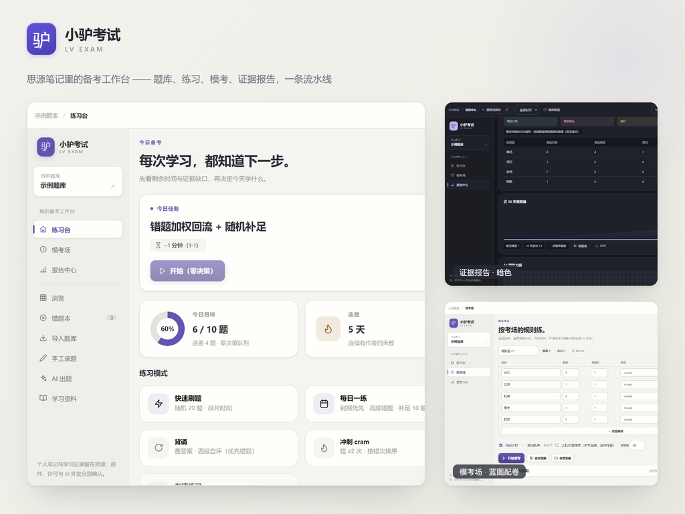

<div align="center">

# 🐴 Lv Exam (Beta) (小驴考试)

> **Beta Notice:** Join QQ group **871707735** for beta feedback, bug reports, and discussions. See [Beta Testing Guide](docs/BETA-TESTING.md).

**Local-first question bank and exam prep workspace in SiYuan: import & manual authoring, independent active-recall practice, wrongbook remediation, timed mock exams, A4 paper printing, FSRS flashcards, and reviewable AI assistance.**

> **Personal Notes → Independent Retrieval → Honest Evidence → Wrongbook Elimination → Timed Mock Verification**  
> Every question is a native, searchable, linkable **SiYuan block** in your own workspace — never locked in an external cloud.

[](https://github.com/xiaolv-suite/siyuan-exam/releases)
[](https://github.com/xiaolv-suite/siyuan-exam/actions/workflows/check.yml)
[](https://github.com/siyuan-note/siyuan)
[](#-license)



*[中文说明](README.md) · English Docs · [Current Status](docs/STATUS.md) · [Todo Pool](docs/TODO-POOL.md) · [Beta Guide](docs/BETA-TESTING.md) · [Delivery Guide](docs/DELIVERY.md) · [UI Components](docs/UI-COMPONENTS.md) · [Contributing](CONTRIBUTING.md) · [Security](SECURITY.md) · [Releases](https://github.com/xiaolv-suite/siyuan-exam/releases)*

</div>

---

## 📦 Core Exam Loop

| Module | Capabilities |
|---|---|
| 📥 **Import & Authoring** | Extract from native SiYuan notes · Import XLSX/XLS, CSV, TSV, GIFT, Aiken · Manual authoring with pin attributes (`pinAttributes`), 4-layer structure with expansion & quick-solve tricks (`expansion`), rubric & image occlusion |
| ✏️ **Independent Practice** | Auto-next on correct with 3.5s countdown & instant advance/pause · Clean recite mode (`reciteToggle`) · Deterministic option shuffling (Fisher-Yates) · Scratchpad fluorescent highlighters · Dark mode diagram inverted filter |
| 🧭 **Diagnosis & Remediation** | Prerequisite DAG diagnostic engine (`diagnoseQuestionRootCauses`) · Automated root cause backtracking & topological learning path synthesis · Active / Eliminated / Archived wrongbook tabs |
| 🏛️ **Marketplace & Ecosystem** | Public domain zero-copyright catalog with 8 core disciplines · Cross-discipline cart & selective stash (`cartItemsToQuestions`) · Quality metrics & taxonomy tree · Non-destructive delta sync & merge · Packaging wizard & privacy sanitizer · Bidirectional interoperability with `siyuan-lv-cards` (`.lvcards`, `lvcards.v1`) · Ecosystem Protocol v1.0.0~v1.6.0 federation (`lvNoticeKit`, `lvTicker`, `withDocLock`, `lvAi`, `lvActivity`, `lvBackup`, `lvLaunchpad`, `lvOmnisearch`, `lvAutomation`) |
| 📝 **Timed Mock Exams** | 100+ CBT question accordion sheet groupings · Post-exam subjective self-rating rubric re-scoring (`rateSubjectiveQuestion`) · Wall-clock timer, snapshot & A4 double-column print sheets |
| 📊 **Evidence Report** | Independent vs. assisted vs. delayed-recall breakdown · 30-day trend, 53-week heatmap, confidence calibration & full local data backup |

---

## 🚀 Quick Start

1. **Manual Installation (Beta Recommended)**:
   - Download `package.zip` from [GitHub Releases](https://github.com/xiaolv-suite/siyuan-exam/releases) and extract into `<Workspace>/data/plugins/siyuan-exam/`;
   - Enable **Lv Exam (Beta) / 小驴考试** in SiYuan `Settings → Marketplace → Downloaded`, then press `Ctrl+Alt+P` (`⌥⌘P` on macOS).
2. **Developer Setup**:
   ```bash
   git clone https://github.com/xiaolv-suite/siyuan-exam.git
   cd siyuan-exam
   pnpm install
   pnpm make-link
   ```

---

## 🔒 Data Sovereignty & Privacy

- **Local-First & Zero Telemetry**: No analytics SDKs, no tracking beacons, 100% offline-capable without AI configured.
- **Native SiYuan Blocks**: Questions live in `题库/<BankName>` notebooks with `custom-exam-*` block attributes; uninstalling the plugin never deletes your questions.
- **Explicit AI Boundary**: Content is sent to your configured AI endpoint only when you explicitly trigger generation, hints, or explanations.

---

## 🧑‍💻 Engineering & Verification

```bash
pnpm check            # typecheck + svelte-check + i18n parity + arch assertions + style audit
pnpm test             # vitest unit & integration suite
pnpm guard            # full quality gate (types + svelte + i18n + arch + styles + lint + test)
pnpm smoke:journey    # live SiYuan kernel end-to-end 5-question journey verification
pnpm build            # production bundle & package.zip generation
```

---

## 📝 Recent Updates

- **SiYuan 3.8.10+ Native Adaptations**: Fullscreen CBT mock exam coordinates folding/restoring native docks (`toggleNativeDock`); report dashboards, review logs, and outline summaries support native document tree context menus (`showDocTreeNativeMenu`); `safeDocTitleFromHPath` protects titles with slashes.
- **Question Drawer Ghost Gap Resolution**: Cleaned up 5 residual malformed `<span>` open tags in `QuestionPeekDrawer`, eliminating ~50px spacing artifacts; restored explicit transition properties and added inline style integrity contracts.
- **Input Method & Touch Polish**: Import tag filter, quick-split input, and occlusion image URL input yield during IME composition; textarea resize grip disabled on touch and narrow viewports.
- **Performance & Engineering Gates**: Info/debug logging gated behind build-time `__LV_EXAM_DEV__`; drawer doc search debounced at 300ms with out-of-order response sequence guards; clipboard error-handling coverage enforced.

<details>
<summary>View Previous Release Highlights (v0.15.1 and earlier)</summary>

### v0.15.1 (2026-11-10)
- Mobile full-screen dialog exit upon opening question notes, paper assemble user notices, Launchpad convergence, and `xiaolv-suite` organization migration.

### v0.15.0 (2026-11-02)
- 3.5s auto-next countdown, recite mode, deterministic option shuffling, scratchpad highlighters, and Public Domain MarketplaceHub.

</details>

---

## 📄 License

Licensed under the [MIT License](LICENSE).
