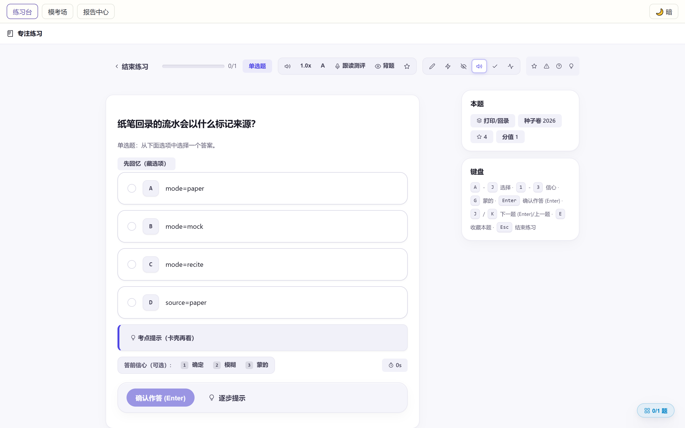
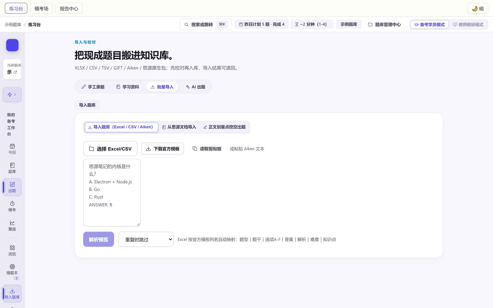
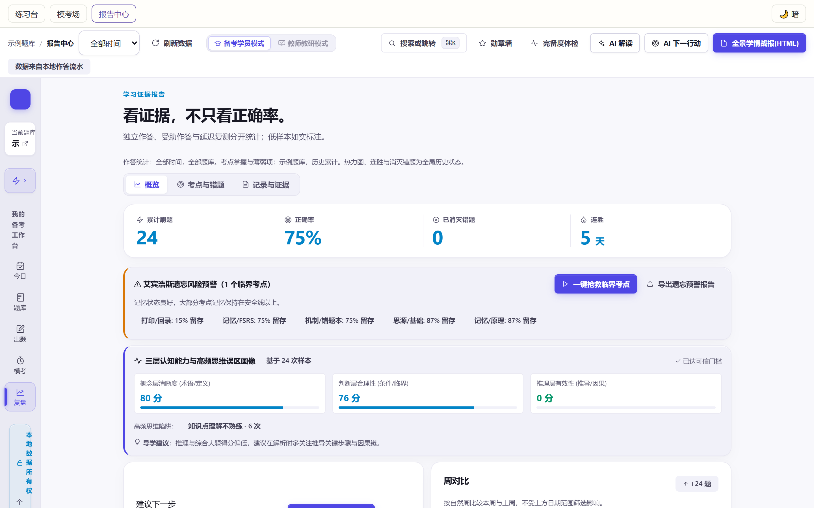

# 小驴考试（内测版）

> **内测说明：** 小驴考试仍处于内测阶段，功能和界面会持续调整，部分能力尚未完成真实思源环境或大题库验证。请先用自有或获准的小样例试用，并为重要资料保留备份。欢迎加入交流 QQ 群 **871707735** 反馈 Bug、提交需求和交流使用体验。

**思源笔记上的本地优先备考工作台：AI 辅助整理与复盘，学习过程和证据可追溯。**

小驴考试（内测版）面向使用思源笔记的自主备考者，把自己的题目、资料、作答与反思连接起来：看清还缺什么，选择下一步练习，再用独立作答与延迟复测检查理解，留下可复用的个人知识。

**用户资料 → 独立作答 → 复盘行动 → 复测 → 个人知识库**

[](https://github.com/ai68298100/siyuan-exam/releases)
[](https://github.com/ai68298100/siyuan-exam/actions/workflows/check.yml)
[](#开发)
[](https://github.com/siyuan-note/siyuan)
[](LICENSE)

[English](README.en-US.md) · [当前状态](docs/STATUS.md) · [交付说明](docs/DELIVERY.md) · [组件清单](docs/UI-COMPONENTS.md) · [贡献指南](CONTRIBUTING.md) · [安全报告](SECURITY.md) · [下载发行包](https://github.com/ai68298100/siyuan-exam/releases) · [查看 R54 UI 原型](design/prototype-r54/index.html) · [反馈问题](https://github.com/ai68298100/siyuan-exam/issues) · [参与讨论](https://github.com/ai68298100/siyuan-exam/discussions)

## 最新版本：v0.12.3（2026-10-27）

本版本为深度批量解耦重构第三波发版：抽离题目浏览详情抽屉（QuestionPeekDrawer）、批量操作浮岛栏（BrowseBatchActionBar）与题库治理维护抽屉集（BrowseMaintenanceDrawers），主文件行数再降 700+ 行突破 8300 行区间！累计解耦逾 2300 行代码，全套单测 181 个测试文件、1411 项单测 100% 全部通过。

<details>
<summary><b>📜 展开查看历史版本更新记录（v0.12.2 及更早版本）</b></summary>

## 上一版本：v0.12.2（2026-10-27）

本版本为深度批量解耦重构持续突破发版：抽离批量导入、纸面背诵与错题本三大巨石子视图，主文件行数再次暴降 600+ 行至 9000 行区间！抽离 ImportStudioView、ReciteStudioView 与 WrongbookStudioView，累计解耦逾 1600 行代码。全套单测 181 个测试文件、1411 项单测 100% 全部通过。

## 上一版本：v0.12.1（2026-10-27）

本版本为深度批量解耦重构发版：四大核心子视图（手工录题/AI命题/学习资料/工坊导航）彻底模块化，主文件代码大幅瘦身 1000+ 行！抽离 ManualStudioView、AiStudioView、MaterialsView 与 StudioSubNav，突破万行巨石大关降至 9600 行以内。全套单测 181 个测试文件、1411 项单测 100% 全部通过。

## 上一版本：v0.12.0（2026-10-27）

本版本为里程碑发版：教师教研与备课工作台（TeacherWorkspaceView）组件级物理彻底解耦与教研分层印卷中心重构。彻底分离学员日常刷题看板与教师教研备课工作台，封装出版级 A4 排版印卷、教师讲义、课后作业单、试题区分度质量诊断与题库归档。全套单测 181 个测试文件、1411 项单测 100% 全部通过。

## 上一版本：v0.11.99（2026-10-27）

本版本为大题共用材料上下文组件（MaterialGroupContextCard）解耦重构与材料组切题展开状态记忆发版。大题同材料组内切题智能保持材料展开状态，免除重复手动展开与寻找；解耦抽离独立的 MaterialGroupContextCard 材料上下文组件。全套单测 181 个测试文件、1411 项单测 100% 全部通过。

## 上一版本：v0.11.98（2026-10-27）

本版本为小组延迟批次复盘小结卡组件（GroupBatchSummaryCard）解耦重构与错题本排序偏好持久化发版。错题队列排序选择器全面对齐本地持久化存储，无缝恢复用户定制排序；解耦抽离独立的 GroupBatchSummaryCard 小结卡组件。全套单测 181 个测试文件、1411 项单测 100% 全部通过。

## 上一版本：v0.11.97（2026-10-27）

本版本为听说跟读评测反馈胶囊组件（SpeechEvalCapsule）抽离解耦与背诵台发音评测闭环发版。解耦抽离独立的 SpeechEvalCapsule 听说发音评测反馈组件，消除做题台与背诵台重复模板；背诵模式全面补齐语音跟读评测交互闭环。全套单测 181 个测试文件、1411 项单测 100% 全部通过。

## 上一版本：v0.11.96（2026-10-27）

本版本为演算草稿纸浮层（ScratchpadDrawer）解耦重构与思源超级块原位定位回跳增强发版。题目详情抽屉升级精准原位定位机制，通过思源原生块协议直跳至具体题目超级块并闪烁聚焦；解耦抽离独立的 ScratchpadDrawer 草稿纸浮层组件，代码结构更清晰。全套单测 181 个测试文件、1411 项单测 100% 全部通过。

## 上一版本：v0.11.95（2026-10-27）

本版本为做题答题卡进度网格弹窗（SessionSheetModal）解耦重构与变式题母题反链溯源闭环发版。一键衍生变式题时自动注入思源超级块反链与母题解析；解耦抽离独立的 SessionSheetModal 会话答题卡网格组件，持续加速页面加载。全套单测 181 个测试文件、1411 项单测 100% 全部通过。

## 上一版本：v0.11.94（2026-10-27）

本版本为空态启程中心思源笔记智能提取直通与题库画廊弹窗（BankGalleryModal）解耦重构发版。空题库主页增设从思源笔记智能提取试题一键直通与切换题库通道；解耦抽离独立的 BankGalleryModal 弹窗组件，主文件体积进一步优化。全套单测 181 个测试文件、1411 项单测 100% 全部通过。

## 上一版本：v0.11.93（2026-10-27）

本版本为做题台浮岛悬浮底座（Floating Dock）聚拢跟手微质感升级与快捷键速查弹窗（ShortcutsHelpModal）解耦重构发版。作答动作区重塑为 20px Bento 圆角微浮岛底座，注入深邃毛玻璃与精细内嵌高光描边，按钮升级为饱满药丸键帽并自带 0.97x 触控微弹性回弹；解耦抽离独立的 ShortcutsHelpModal 弹窗组件，净化主文件状态。全套单测 181 个测试文件、1411 项单测 100% 全部通过。

## 上一版本：v0.11.92（2026-10-27）

本版本为错题本顽疾错题一键推送到闪卡（Wrongbook to FSRS）高光操作实装与做题结算卡组件（PracticeDoneCard）解耦重构发版。错题列表对连错≥2次顽疾题提供高光【推闪卡】动作，顽疾题筛选下顶栏推闪卡按钮高亮联动；解耦抽离独立的 PracticeDoneCard 纯净战报组件，降低 PracticeTab 巨石体积。全套单测 181 个测试文件、1411 项单测 100% 全部通过。

## 上一版本：v0.11.91（2026-10-27）

本版本为思源 3.8.9-beta.2 新建示例题库瞬态 metadata not ready 自动自愈修复、思源文档提取“缺少 ANSWER 行”友好化升级、长文划词制卡协议（Extract to Quiz）与学情薄弱考点生态反哺发版。全面提升新内核新建题库稳定性；智能消除笔记提取生硬报错并接入阅读切片制卡；开放 extractToQuiz 服务桥打通长文制卡出题闭环；实装正确率<60%薄弱考点生态广播与暗色模式微边框。全套单测 181 个测试文件、1411 项单测 100% 全部通过。

## 上一版本：v0.11.90（2026-10-27）

本版本为模考交卷标准生态事件（lv-exam:session-ended）联邦规范落地、英文文档全景翻新与仓库卫生加固发版。全真模考场（MockTab）交卷结算补齐生态广播与防题干泄漏规范；全量重构英文 README.en-US.md 与 docs/STATUS.md 消除跨版本信息断层；.gitignore 补齐构建哈希忽略保持工作区纯净。全套单测 181 个测试文件、1407 项单测 100% 全部通过。

## 上一版本：v0.11.89（2026-10-27）

本版本为多语言听说录音跟读评测引擎实装与发音匹配即时反馈版本。实装发音匹配评测算法（speechEval.ts），智能比对学生跟读录音与目标原声文本；做题台与背诵台新增【录音跟读测评】交互闭环与匹配度打分胶囊。全套单测 181 个测试文件、1406 项单测 100% 全部通过。

## 上一版本：v0.11.88（2026-10-27）

本版本为 K12 拼音声调智能转换判分与错题清零纯净重测卷实装版本。实装汉语拼音声调转换算法（pinyinToNumbered），数字声调（如 qie4）与声调符号（如 qiè）自动互通判分；错题本实装【错题清零纯净重测卷】A4 双栏打印通道，包含目标条与二次反思框。全套单测 180 个测试文件、1400 项单测 100% 全部通过。

## 上一版本：v0.11.87（2026-10-27）

本版本为复盘学情中心阶段通关学习地图（Roadmap）与核心阻断溯源关键链实装版本。考点掌握度面板新增【通关地图】呈现分面，自底向上划分自适应攻坚阶段；实装核心阻断溯源关键链直观预警与一键阶段攻坚。全套单测 180 个测试文件、1399 项单测 100% 全部通过。

## 上一版本：v0.11.86（2026-10-27）

本版本为主观题全真稿纸横线背景模式、练习结算全对通关卡片与端到端交互加固版本。模考主观题答题框实装 28px 规范信纸横线背景模式；练习台结算页新增 100% 全对通关高光卡片与下一阶段模考/学情导学通道。全套单测 180 个测试文件、1399 项单测 100% 全部通过。

## 上一版本：v0.11.85（2026-10-27）

本版本为全真模考场（MockTab）富文本渲染、考场朗读与手工录题多学段符号坞实装版本。考场题面补齐 LaTeX 公式与 Markdown 渲染引擎及音标胶囊；考场操作栏实装字号多档微调与一键语音朗读；录题工坊新增【数理公式】·【幼小拼音】·【国际音标】三合一符号坞。全套单测 180 个测试文件、1399 项单测 100% 全部通过。

## 上一版本：v0.11.84（2026-10-27）

本版本为中级考证与高数全真蓝图预设实装及全线依赖安全升级版本。实装《中级会计实务》与《大学高等数学微积分》标准化组卷蓝图预设；全面升级 Svelte 5.57.2、Playwright Core 1.64.1、Prettier 3.9.10 等核心开发依赖，合入 Dependabot 待更新项保持仓库前沿健康。全套单测 180 个测试文件、1399 项单测 100% 全部通过。

## 上一版本：v0.11.83（2026-10-26）

本版本为复盘学情报告（ReportTab）教师教研与备考学员角色专属工作台解耦与试题区分度质量诊断实装版本。教师模式新增【试题区分度与质量】第4专属分区，展示平均区分度D与通过率P、Ebel等级胶囊分布、负区分度题目排查与一键导出区分度CSV；顶栏工具按教师与学员角色分流（区分度/导学案 vs 勋章墙/完备度）。全套单测 180 个测试文件、1399 项单测 100% 全部通过。

## 上一版本：v0.11.82（2026-10-26）

本版本为学习资料库思源块链接智能解析、做题字号多档微调与抗遗忘背诵抢救通道实装版本。学习资料登记自动识别思源块链接并提取笔记标题；做题台与背诵台实装标准（16px）、大号（19px）与特大（22px）三档题干字号微调；艾宾浩斯记忆急救横幅新增【背诵抢救】通道。全套单测 180 个测试文件、1399 项单测 100% 全部通过。

## 上一版本：v0.11.81（2026-10-26）

本版本为全场景研学（K12全科、大学硕博、职业考证、多语言）示范题库与蓝图预设分组全面落地发版。实装K12全科题库（幼小初高）与大学考研硕博高阶题库（微积分/线代/马哲）；全真模考蓝图预设重构为【职业考证】·【大学学术】·【K12基础】·【公考法考】·【语言微测】五组清晰optgroup分组；题库画廊与空态直通车全面覆盖5大学段。全套单测 180 个测试文件、1399 项单测 100% 全部通过。

## 上一版本：v0.11.79（2026-10-26）

本版本为备考学员与教师教研双角色专属工作台彻底解耦与功能融入版本。彻底解耦学生自测看板与教师备课界面，学员模式纯净聚焦于“背诵 ➔ 自测 ➔ 模考 ➔ 错题消灭”；教师教研模式融入 A4 双栏试卷印刷、教师讲义教案、课后分层作业单、全库区分度诊断、命题工坊与思源文档同步。全套单测 180 个测试文件、1397 项单测 100% 全部通过。

## 上一版本：v0.11.78（2026-10-26）

本版本为学习全生命周期流程（概念背诵内化/日常靶向自测/全真模拟实战/学情复盘诊断）融入与键盘选择器加固版本。主屏清晰呈现三大研学跑道，打破单一刷题局限，确立“输入理解 ➔ 背诵内化 ➔ 日常自测 ➔ 全真模考 ➔ 学情复盘”的完整学习认知闭环；无障碍键盘文件选择器原生事件加固。全套单测 180 个测试文件、1397 项单测 100% 全部通过。

## 上一版本：v0.11.77（2026-10-26）

本版本为解决“页面混乱不知所措”系统性重塑主工作区、升维全学段研学启程中心版本。彻底解耦空题库与有题工作台状态，根治0题仪表盘堆叠乱象；主屏与题库画廊实装K12基础教育、大学考研硕博、职业考证与多语言研学四大支柱选择漏斗；顶栏与侧栏信息架构重构降噪。全套单测 180 个测试文件、1397 项单测 100% 全部通过。

## 上一版本：v0.11.76（2026-10-26）

本版本为 TTS 语音朗读 Markdown/LaTeX 杂音过滤与模态确认弹窗优雅换行修复版本。朗读引擎新增净化过滤，自动剥离题干解析中的 Markdown、HTML、思源 IAL 与 LaTeX 符号，彻底杜绝语音怪音杂音；模态确认弹窗内容容器补全 `white-space: pre-wrap` 样式，考场交卷与二次确认保持多段落优雅排版。全套单测 180 个测试文件、1397 项单测 100% 全部通过。

## 上一版本：v0.11.75（2026-10-26）

本版本为多语言研学（英语/粤语双主导）、从业资格认证（教师资格证/基金从业资格）与 K12 升学体系顶层融合实装版本。语言类学习全面升级为英语、粤语双主导研学，英语题库支持 IPA 国际音标与 en-US 发音；实装教师资格证（NTCE）与基金从业人员资格考试真题题库与蓝图预设；题库画廊与空态引导重构为【资格认证】·【英语研学】·【粤语口语】·【综合通识】顶层多维研学选择漏斗。全套单测 180 个测试文件、1396 项单测 100% 全部通过。

## 上一版本：v0.11.74（2026-10-26）

本版本为纸面背诵模式自动伴读与结算完成闭环升级版本。背诵模式操作坞新增自动伴读开关，切题自动朗读题干，揭晓自动朗读正解；背诵完成页重塑为 Bento 双重行动卡，存在忘却卡时支持一键重背、推送到闪卡或加入待办，全熟练通关时提供开启下一轮背诵与查看报告通道。全套单测 179 个测试文件、1392 项单测 100% 全部通过。

## 上一版本：v0.11.73（2026-10-26）

本版本为题目抽屉衍生变式题、模考交卷防漏答题号提醒与学情薄弱考点专项特训闭环版本。题目详情抽屉支持一键将当前考题载入手工录题台衍生变式题；全真模考场提前交卷二次确认弹窗明确列出具体未答题号，防漏做保护升级；学情报告薄弱考点榜新增【专项特训】按键，直接发起该考点专属攻坚刷题。全套单测 179 个测试文件、1392 项单测 100% 全部通过。

## 上一版本：v0.11.72（2026-10-26）

本版本为思源笔记原生块（表格题表、折叠卡、粗体概念定义）无痛转换引擎全面实装版本。原生支持思源笔记中的 Markdown 题目表格（含 `| 题目 | 选项A-D | 答案 | 解析 | 考点 |` 或 `| 单词 | 释义 |`），自动映射为选择题与填空题；完美支持折叠块自制问答卡（`<details><summary>问</summary>答</details>`）及读书笔记概念卡（`**概念术语**：定义内容`）的智能提取转换。全套单测 179 个测试文件、1392 项单测 100% 全部通过。

## 上一版本：v0.11.71（2026-10-26）

本版本为思源笔记导入题库能力全面进化与候选多选提取体验升级版本。思源文档提取引擎兼容超级块（`{{{row`）与标题行前缀，任务列表复选框智能识别（`- [x] B. 选项` 自动提取为答案 B）；原生高亮挖空（Cloze）兜底：阅读笔记无标准题号但包含 `==重点==` 时自动提取为填空题；文档候选列表支持多选勾选批量提取，空搜索时默认展示最近编辑笔记。全套单测 179 个测试文件、1390 项单测 100% 全部通过。

## 上一版本：v0.11.70（2026-10-26）

本版本为学情复盘呈现形式胶囊坞与 AI 候选审核批量工具栏升级版本。学情报告考点掌握度图表雷达与表格清单重构为结构化胶囊滑块坞（`.lv-session-dock`）；AI 出题工作台候选审核池增加批量清空队列与批量采纳状态栏，消除堆叠与误点。全套单测 179 个测试文件、1389 项单测 100% 全部通过。

## 上一版本：v0.11.69（2026-10-26）

本版本为错题本多维排序机制与长材料阅读区域最大高度保护落地版本。错题队列新增多维排序选择器（最新错题优先 / 犯错频次降序 / 按考点聚类），支持精准聚焦连续失误的高频顽固考点；做题台阅读材料展开后限制最大高度为 280px 并开启平滑内联滚动，彻底杜绝长篇材料将下方题目与选项无限推离视区。全套单测 179 个测试文件、1389 项单测 100% 全部通过。

## 上一版本：v0.11.68（2026-10-26）

本版本为手工录题理科符号快捷插入条、做题主观题横线纸质感与快捷键四分类滑块坞落地版本。在手工录题题干上方新增常用数学物理符号快捷插入坞（x² / √x / a/b / ∑ / ∫ / π / α / β / θ / ± / ≤ / ≥ / ∞）；做题台主观题作答框支持一键切换真实信纸横线背景模式，文字与格线精准对齐；快捷键速查弹窗重构为【全部 / 做题台 / 纸面背诵 / 全局导航】四组交互 Tab。全套单测 179 个测试文件、1389 项单测 100% 全部通过。

## 上一版本：v0.11.67（2026-10-26）

本版本为题库中心场景分类过滤坞、题库浏览悬浮批量操作坞与学情四象限可交互下钻落地版本。题库画廊弹窗顶部增设场景分类胶囊坞（全部/备考/语言/教研/通识），支持根据分类快速筛选题库资产；题库浏览批量模式下长列表勾选题目的同时，底部悬浮展示高光操作坞（已选 N 题 / 开始特训 / 打印试卷 / 推送闪卡），无需滚动回顶部；复盘报告四象限指标卡（盲区/侥幸）支持一键点击下钻靶向题目。全套单测 179 个测试文件、1389 项单测 100% 全部通过。

## 上一版本：v0.11.66（2026-10-26）

本版本取消了思源启动时【练习台】自动弹出的强制行为，并重构了练习结算闭环与行动层级。取消 `onLayoutReady` 生命周期中强制无差别执行 `this.openPractice()`，思源启动时插件完成静默初始化并挂载服务桥，用户通过顶栏按钮、命令面板或快捷行动主动进入练习台，彻底杜绝开软件弹窗打扰；做题完成时有错题自动以 Bento 卡片高亮展示【🎯 立即重练同考点 (Primary)】与【▸ 展开错题剖析】，全对通关时提供【⚡ 开启下一轮练习】与【📊 查看学情诊断】。全套单测 179 个测试文件、1389 项单测 100% 全部通过。

## 上一版本：v0.11.65（2026-10-26）

本版本为题库管理多维筛选分层重构与做题台信心/错因微触感操作坞升级版本。题库浏览 15 项筛选重构为双层分界架构：搜索框与题型/状态/来源/天数归入首行，错题/争议/受助/收藏与标签筛选收敛为状态快速过滤坞与标签过滤坞；做题台作答前信心自评与作答后错因归类重构为统一规范的胶囊操作坞（`.lv-session-dock`）。全套单测 179 个测试文件、1389 项单测 100% 全部通过。

## 上一版本：v0.11.64（2026-10-26）

本版本为全场景界面交互打磨版本，覆盖纸面背题模式、题目详情抽屉、全真模考控制台、复盘报告与学习资料库。背诵模式顶部增加动态自适应进度条与操作坞，答案揭晓按钮增加空格盲打提示，自评完成页升级为四档 Bento 成绩卡片；题目浏览抽屉背景模糊加深至 14px 毛玻璃，圆角升级至 22px Bento 大圆角；模考配置 10 按钮解耦为起考主操作区与文档导出/高级组卷两层结构；报告中心分区选项卡注入单色矢量微标与胶囊底托。全套单测 179 个测试文件、1389 项单测 100% 全部通过。

## 上一版本：v0.11.63（2026-10-26）

本版本为全系统颜色体系终极梳理与宿主主题依赖彻底肃清版本。正式补齐并全局消费 `--lv-on-accent`、`--lv-on-green`、`--lv-on-red`、`--lv-on-amber` 与 `--lv-brand-deep` 语义对比色 Token，杜绝依赖第三方不稳定的宿主配色；彻底替换数学坐标系、数轴区间高亮及统计饼图/柱状图中的残留色值，统一为小驴学习的高阶调色盘；首页倒计时图标升级为专属学院蓝微质感胶囊（`.lv-streak-flame--clock`），选区背景色（`::selection`）完全统一为专属靛蓝软高光。全套单测 179 个测试文件、1389 项单测 100% 全部通过。

## 上一版本：v0.11.62（2026-10-26）

本版本为四大研学场景专属色彩体系落地、导入分面胶囊化与 AI 出题参数矩阵结构化升级版本。在 `lv-tokens.scss` 中正式建立四大研学场景专属色调（全真备考 `#0284c7` / 多语言研学 `#8b5cf6` / 教学教研 `#059669` / 综合研学 `#d97706`），并在题库中心以独立微质感场景徽章（`.lv-scene-badge`）呈现；导入页面 3 大子分面升级为结构化胶囊滑块组，AI 出题工作台 4 大参数控制器完成聚合重构。全套单测 179 个测试文件、1389 项单测 100% 全部通过。

## 上一版本：v0.11.61（2026-10-26）

本版本为错题本工具栏双栏解耦重构与手工录题题型/状态双胶囊滑块组升级版本。错题本队列工具栏将 3 大分类选项卡（活跃/归档/消灭）与 6 大攻坚行动彻底解耦，左侧采用胶囊导航坞，右侧整齐排列攻坚动作；出题工作台将题型与生命周期状态按钮重构为自适应紧凑双胶囊滑块组，OCR 弹窗边框颜色彻底规整为独立品牌主题色。全套单测 179 个测试文件、1389 项单测 100% 全部通过。

## 上一版本：v0.11.60（2026-10-26）

本版本为题库浏览行（.lv-qrow）Bento 柔和质感与背诵自评按键（.lv-rate）物理微触感优化版本。题目浏览项升级为 18px Bento 柔和圆角（`--lv-r-3`）并注入高光内阴影（`--lv-inset-card`），内边距放宽为 15px 18px；背诵自评按键升级为 12px 现代圆角（`--lv-r-2`）与专属高光内阴影，按键数字块随等级着色。全套单测 179 个测试文件、1389 项单测 100% 全部通过。

## 上一版本：v0.11.59（2026-10-26）

本版本为首页区段标题矢量图标引导、Hero 主按钮独立投影与布局节奏优化版本。在首页研学模式与快速工具区段标题中加入极简单色线性矢量图标与副标题指引，大幅提升界面呼吸感；规整主按钮投影至专属独立靛蓝柔光微阴影（`var(--lv-btn-primary-shadow)`），优化计划说明字重与多栏自适应折叠布局。全套单测 179 个测试文件、1389 项单测 100% 全部通过。

## 上一版本：v0.11.58（2026-10-26）

本版本为结算战报三联 Bento 仪表盘升级、深度解析全圆角卡片与改答错因框质感优化版本。做题完成后的三联成绩看板升级为独立次表面底衬卡片，大数字字号加固至 26px 等宽排版；解析卡片升级为四边圆角完整、微阴影、带左侧高雅深色强调线的优雅卡片；改答错因框升级为 18px 柔和圆角与高光内阴影。全套单测 179 个测试文件、1389 项单测 100% 全部通过。

## 上一版本：v0.11.57（2026-10-26）

本版本为做题操作坞（Session Toolbar Dock）双组结构化重构与交互流连贯性优化版本。将以往挤压在单行的散乱按钮收敛为【核心学习操作坞（朗读/背题/收藏）】与【辅助工具坞（草稿/极速/盲听/音效/快捷键）】，在窄屏与平板分屏下极大消除拥挤与视觉噪音；统一操作坞胶囊按钮的微触感（hover 浮白底、激活微阴影），优化做题主卡片下边距与大题流转节奏。全套单测 179 个测试文件、1389 项单测 100% 全部通过。

## 上一版本：v0.11.56（2026-10-26）

本版本为全局对话框大圆角升级、弹窗毛玻璃背景模糊与错题列表 Bento 质感落地版本。全局模态对话框与题库管理弹窗统一升级至 22px 现代大圆角（`--lv-r-4`），背景蒙层模糊深度提升至 14px 毛玻璃，弹窗标题栏图标升级为 24px 高级微发光徽标；错题本列表行升级为 18px 现代圆角（`--lv-r-3`）并注入高光内阴影（`--lv-inset-card`），角色分段控件选中态完全与独立高阶调色盘对齐。全套单测 179 个测试文件、1389 项单测 100% 全部通过。

## 上一版本：v0.11.55（2026-10-26）

本版本为模考场选项卡、答题卡网格与报告中心四象限指标卡 Bento 质感对齐升级版本。做题选项卡对齐 18px Bento 柔和圆角与高光内阴影（`--lv-inset-card`），题干增加抗锯齿字体平滑渲染，答题卡格子规范为 12px 现代圆角与微漫反射软阴影；复盘报告中心四象限指标卡（`.lv-quad`）升级为 18px Bento 圆角并注入高光内阴影。全套单测 179 个测试文件、1389 项单测 100% 全部通过。

## 上一版本：v0.11.54（2026-10-26）

本版本为做题选项卡 Bento 触感微调、高光内阴影与题干抗锯齿排版质感优化版本。选项卡圆角规范至 18px Bento 柔和圆角（`--lv-r-3`），引入专属高光内阴影（`--lv-inset-card`），悬停平滑上浮 1.5px 并泛出柔光微阴影，选中项增加 1.5px 纯正靛蓝强调环与柔和底色；题干增加 `-webkit-font-smoothing: antialiased` 字体平滑抗锯齿，即时答案反馈框（`.lv-feedback`）升级为 18px 柔和圆角与 4px 纯色微边线。全套单测 179 个测试文件、1389 项单测 100% 全部通过。

## 上一版本：v0.11.53（2026-10-26）

本版本为小驴学习独立现代设计系统（Design System）全面实装与 Hero 微渐变质感落地版本。彻底解除对第三方思源主题配色的强制依赖，建立插件专属独立的 Slate 现代高对比度冷灰白底（`#f8fafc`）、Bento 纯白高光卡片、普鲁士学院蓝（`#0284c7`）与靛蓝紫（`#4f46e5`）核心调色盘，兼备 Apple 风格暗黑夜空深邃模式（`#090d16`）；首页 Hero 区域升级为现代微发光双层渐变，按压与悬停交互微抬升 1.5px 伴随轻柔漫反射光晕。全套单测 179 个测试文件、1389 项单测 100% 全部通过。

## 上一版本：v0.11.52（2026-10-26）

本版本为题库健康体检（bankHealth）全入口空值防御与畸变数据保护加固版本。在 `bankHealth.ts` 中对题库列表与题目对象全面引入安全数组规整与有效 ID 校验，杜绝 `qs` 或 `q.options` 未定义引发的空指针崩溃；在材料组关联排查与孤儿队列导出时增加强对象空值拦截与安全链访问，补齐 `bankHealth.test.ts` 自动化防御单测。全套单测 179 个测试文件、1389 项单测 100% 全部通过。

## 上一版本：v0.11.51（2026-10-25）

本版本为手工录题注音支持、思源块属性 studyMeta 双向无损编解码与抽屉发音联动版本。在手工录题表单中新增朗读语言（普通话/粤语/英语/日语）与注音/粤拼专属输入区域；在 `blockTemplate.ts` 中打通 `exam-study-meta` 的 IAL 属性持久化与读回还原，在题目编辑（`updateQuestionContent`）中支持保存研学元数据；在题目详情抽屉（Peek Drawer）中全面补齐注音徽章渲染与【▶ 听发音】快捷按钮。全套单测 179 个测试文件、1388 项单测 100% 全部通过。

## 上一版本：v0.11.50（2026-10-25）

本版本为研学场景分类动态切换（updateBankCategory）与全链路品牌升级深度梳理落地版本。在题库管理中心支持点击场景分类徽章一键循环切换（全真备考 / 多语言研学 / 教学教研 / 综合研学），在 `app.ts` 中新增 `updateBankCategory` 与 `createBank` 分类参数，并补齐 `bankCategory.test.ts` 自动化单测覆盖；系统清理深层报告与 CSV 导出文件中的旧版残留，全面切换为【小驴学习（原小驴考试）】全新品牌规范。全套单测 179 个测试文件、1387 项单测 100% 全部通过。

## 上一版本：v0.11.49（2026-10-25）

本版本为【小驴学习】品牌升维更名、课后作业导学单打印与题库研学场景分类落地版本。正式更名升级为【小驴学习（原小驴考试） (Lv Study)】，从单纯刷题扩展为涵盖语言习得（粤语/英语/日语）、读书制卡、通识研学、学校教研与全真模考的终身研学中枢，原有题库、模考、答卷与作答流水 100% 完整继承；上线教师课后作业导学单打印引擎 `buildStudentHomeworkSheetPro`；建立四大研学场景分类定义。全套单测 178 个测试文件、1383 项单测 100% 全部通过。

## 上一版本：v0.11.48（2026-10-25）

本版本为教师教研模式专属工作台卡片、讲义教案与双栏测试卷一键导出落地版本。当顶部角色切换至【教师教研模式】时，练习台首页自动呼出专属“教师教研工具箱”，提供录题、导出讲义、打印双栏卷与试题质量诊断四大核心教学通道；一键调用 `buildTeacherLectureSheetPro` 与 `buildCompactQuestionSheetPro` 生成带解析与评分标准的教案讲义卷。全套单测 178 个测试文件、1382 项单测 100% 全部通过。

## 上一版本：v0.11.47（2026-10-25）

本版本为粤语研学题库一键创建落地、题库中心直达入口与示范题库构建管道解耦升级版本。在 `app.ts` 中将 `createSampleBank` 升级为解耦路由，支持一键创建“【示例】粤语日常实用研学题库”独立笔记本文档，涵盖问候、茶楼、语法、粤拼与俚语全套研学卡；在空状态卡片与题库管理中心（Bank Hub）弹窗中增设【粤语研学示例】一键开练入口。全套单测 178 个测试文件、1382 项单测 100% 全部通过。

## 上一版本：v0.11.46（2026-10-25）

本版本为粤语实用口语示范题库内置上线、题干注音徽章渲染与粤语发音联动版本。原创内置涵盖日常问候（“唔该”）、茶楼文化（“埋单”）、倒装语法（“行先”）、标准粤拼（“dim2 gaai2”）与客套俚语（“得闲饮茶”）的五大典型粤语研学卡（`cantoneseSample`）；在做题与背诵界面自动渲染雅致注音徽章，点击发音按钮自动按 `studyMeta.lang`（如 `zh-HK`）调度正宗方言朗读。全套单测扩充至 178 个测试文件、1381 项单测 100% 全部通过。

## 上一版本：v0.11.45（2026-10-25）

本版本为泛语言学习方言朗读（粤语 zh-HK / 英语 en-US 等）与研学元数据扩展升级版本。在 `tts.ts` 中升级 `ttsSpeak` 原生支持多语言与粤语等方言（`STUDY_LANGUAGES`），100% 保持向后兼容；在 `types.ts` 的 `Question` 领域模型中正式引入 `studyMeta` 语言与音频研学元数据。全套单测 177 个测试文件、1378 项单测 100% 全部通过。

## 上一版本：v0.11.44（2026-10-25）

本版本为智能筛选视图（applyView / upsertView / exportSmartViewsJson）空值防御与健壮性升级版本。在 `smartViews.ts` 中对传入的题目列表与视图规格全面引入对象与数组强防御，杜绝 `view.v` 或 `view.search` 未定义空指针引发的未捕获崩溃；在选项与题干关键词匹配时增加数组与非空规整。全套单测 177 个测试文件、1377 项单测 100% 全部通过。

## 上一版本：v0.11.43（2026-10-25）

本版本为全量数据自检与完整性审计（auditDataIntegrity / exportIntegrityCsv）空值防御升级版本。在 `dataIntegrity.ts` 中对题库题目列表、作答流水列表与错题快照列表全面引入安全数组规整与有效 ID 过滤，杜绝 `options.questions.map` 未定义空指针引发的未捕获崩溃；在导出完整性报告 CSV 时增加强对象空值拦截与 `issues` 安全数组规整。全套单测 177 个测试文件、1376 项单测 100% 全部通过。

## 上一版本：v0.11.42（2026-10-25）

本版本为试题使用深度分析与干扰项效率评估（analyzeQuestionUsage / exportItemAnalysisCsv）全防御升级版本。在 `itemAnalysis.ts` 中对传入的题目对象、题目选项与作答流水全面引入安全数组兜底与有效题目 ID 守卫，杜绝 `q.id` 空指针或选项非数组引发的未捕获崩溃；在 CSV 导出与全库诊断中增加强对象空值拦截与选项安全规整。全套单测 177 个测试文件、1375 项单测 100% 全部通过。

## 上一版本：v0.11.41（2026-10-25）

本版本为题目曝光去重（helpFromExposure / exposureNodeCounts / seenIndex）空值防御与健壮性升级版本。对受助节点传入增加空值守卫，杜绝 `undefined` 传给 `new Set` 时抛出异常；在曝光节点计数与跨模式索引中全面引入安全数组兜底与有效题目 ID 校验。全套单测 177 个测试文件、1374 项单测 100% 全部通过。

## 上一版本：v0.11.40（2026-10-25）

本版本为艾宾浩斯复习负荷预测与导出（forecastFutureLoad / exportLoadForecastCsv）空值防御与健壮性升级版本。在 `loadForecast.ts` 中对题库列表与作答流水全面引入安全数组兜底与有效题目 ID 守卫，杜绝 `questions.length` 未定义空指针引发的未捕获崩溃；在导出负荷预测 CSV 时增加强对象空值拦截与 `days` 安全数组规整。全套单测 177 个测试文件、1373 项单测 100% 全部通过。

## 上一版本：v0.11.39（2026-10-25）

本版本为模考百分位排名估算与正态分布曲线导出空值防御升级版本。对传入的模型对象与均值/标准差全面引入 `Number.isFinite` 与未定义前置守卫，模型缺失时自动回退至标准通用虚拟模型，彻底杜绝未定义对象访问崩溃；在百分位 CSV 导出中对分数段列表进行数组强校验。全套单测 177 个测试文件、1372 项单测 100% 全部通过。

## 上一版本：v0.11.38（2026-10-25）

本版本为考前急救冲刺调度（extractCramCandidates / extractVariantQuestions）空值防御与健壮性加固发版。在 `cramScheduler.ts` 中对题目全量列表、错题快照列表全面引入数组安全规整，彻底杜绝在空题库或异常入参下遍历未定义对象崩溃；对变式题提取进行非空与有效 ID 前置守卫。全套单测 177 个测试文件、1371 项单测 100% 全部通过。

## 上一版本：v0.11.37（2026-10-25）

本版本为面包屑分隔符视觉比例校准、侧栏分组标签字距微调与整体 UI 质感打磨版本。顶栏面包屑分隔符字体规范为 12px 并注入 60% 呼吸透明度，与题库名和当前位置文字中轴线与基准线完美对齐；侧栏工作台分组标签微调为 11px 加粗 600、0.6px 字母呼吸间距。全套单测 177 个测试文件、1370 项单测 100% 全部通过。

## 上一版本：v0.11.36（2026-10-25）

本版本为阅读切片闪卡导出（exportCardsMarkdown / exportCardsCsv）空值防御与畸变容错升级版本。对导出函数入参进行对象与数组强类型检验，杜绝传入 `null`、`undefined` 或畸变对象时引发崩溃；在格式化各题型选项与卡片标签时加入 `Array.isArray` 强校验，防止属性非数组时调用 `join` 抛出异常。全套单测 177 个测试文件、1370 项单测 100% 全部通过。

## 上一版本：v0.11.35（2026-10-25）

本版本为作答时间预算估算空值防御与流水用时非负规整升级版本。在 `timeBudget.ts` 中对传入的题目队列与作答流水全面引入数组安全规整与非有限数值过滤，杜绝异常外部数据传入时抛出未捕获异常；在 `attemptLog.ts` 中对入库事件的 `timeMs` 字段增加 `Number.isFinite` 与非负规整，彻底防止因本地设备时钟波动产生负用时或 NaN。全套单测 177 个测试文件、1369 项单测 100% 全部通过。

## 上一版本：v0.11.34（2026-10-25）

本版本为顶栏角色切换图标矢量化升级、顶栏排版收敛与品牌视觉深化版本。备考学员与教师教研模式分段控件彻底告别生硬 Emoji，升级为高质感现代单色线性矢量图标——学士帽（`academic`）与讲台黑板（`teacher`）；收敛合并 SCSS 中重复的工具条规则，采用统一的 44px 紧凑舒适高度与 0 1px 3px 微扩散底阴影，优化眉题（Eyebrow）字重与字间距。全套单测 177 个测试文件、1368 项单测 100% 全部通过。

## 上一版本：v0.11.33（2026-10-25）

本版本为做题卡片瓷砖微动效、模式卡片悬浮投影与全真交互细节升级版本。主页练习模式卡片在鼠标悬停时平滑抬升 2px，并触发深度扩散的普鲁士学院蓝柔光阴影（`0 6px 20px color-mix(...)`），图标容器采用规范的 12px 圆角与微高光，触感轻盈高级；指标统计小部件统一采用 18px Bento 柔和圆角与高反差 hover 学院蓝微边框反馈。全套单测 177 个测试文件、1368 项单测 100% 全部通过。

## 上一版本：v0.11.32（2026-10-25）

本版本为考场配时策略沙盘空值防御与复盘 Markdown 表格转义安全升级版本。在 `pacingStrategy.ts` 中对蓝图配置、分段数组与实际用时字典全面引入空值安全规整，彻底消除未定义入参导致的崩溃隐患；在导出考场配时沙盘报告时对分段大题名称与复盘建议中的竖线（`|`）和换行进行 HTML 实体转义，防止报告表格结构被意外破坏。全套单测 177 个测试文件、1368 项单测 100% 全部通过。

## 上一版本：v0.11.31（2026-10-25）

本版本为左上角去除“驴”字更换插件官方矢量Logo、吸收小驴生态微质感规范与首页Bento全景升级版本。侧栏顶部彻底移除生硬文字，升级为学院蓝渐变微光底衬与官方满分通关双层题卷矢量徽标（`#iconExam`）；深度吸收小驴打卡与小驴人脉微质感规范（Micro-surface Elevation），重塑卡片微阴影系统与 18px Bento 大圆角；优化今日任务 Hero 卡片为双色柔光线性渐变，节奏周卡片升级为内敛圆角微阴影。全套单测 177 个测试文件、1367 项单测 100% 全部通过。

## 上一版本：v0.11.30（2026-10-25）

本版本为左侧栏图标系统全面重绘去重、Logo 质感重塑与首页 Bento 美学升级版本。重绘今日日程板（`home`）、题库展开卷册（`book`）、出题写作工坊（`create`）、考场精准秒表（`clock`）、复盘增长折线（`chart`）、题卡画廊群（`grid`）、错题靶心攻坚（`target`）、手持录题板（`clipboard`）与书签文献手册（`material`），彻底消灭“出题/录题皆为铅笔”、“题库/资料皆为书籍”的重复缺陷；重构品牌 Logo 为学院蓝质感渐变勋章；优化首页空状态卡片留白排版。全套单测 177 个测试文件、1367 项单测 100% 全部通过。

## 上一版本：v0.11.29（2026-10-25）

本版本为主观题采分点对齐防御、Markdown 诊断表格转义与计划欠账算法安全升级版本。在 `rubricEvaluator.ts` 中对作答文本与 `criteria` 采分点列表增加数组与字符串强类型防御，杜绝异常题型输入引发崩溃；并在导出诊断 Markdown 表格时对竖线（`|`）和换行进行实体转义，防止报告表格排版被撕裂；在 `dailyPlan.ts` 中对计划题数与昨日完成数引入 `Number.isFinite` 与非负规整。全套单测 177 个测试文件、1367 项单测 100% 全部通过。

## 上一版本：v0.11.28（2026-10-25）

本版本为全量 Playwright 真实 UI 深度走查、无头渲染优化与 E2E 端口竞态加固发版。覆盖真实界面浏览、导入、录题、AI、资料、背诵、作答反馈到全量 11 组复杂维护面板（模考成绩单、报告考点下钻、批量编辑、题库健康、勘误回导、纸笔回录、考点管理、更多菜单、逐步提示、退出确认、背诵完成），实现真实无头浏览器端到端零警告零报错执行；在走查脚本中自适应感知题型与作答完成态。全套单测 177 个测试文件、1365 项单测 100% 全部通过。

## 上一版本：v0.11.27（2026-10-25）

本版本为错题本已消灭通关错题检阅与重测回册闭环升级版本。在错题本队列上方新增【已消灭通关 ({n})】独立选项卡，让老用户随时检阅连续做对 2 次成功消灭的错题战果；在已消灭列表中清晰展示消灭时间与历史做错次数，支持一键“重练此题”开启防遗忘单题复测，或一键“重新回册”重新收录入在册错题库。全套单测 177 个测试文件、1365 项单测 100% 全部通过。

## 上一版本：v0.11.26（2026-10-25）

本版本为全量真实浏览器 Playwright 端到端（E2E）验收、老用户时钟漂移保号修复与断点对齐升级版本。全面通过 5 组跨模块真实浏览器自动化端到端测试（`smoke-workflows-ux.mjs`、`smoke-ui.mjs`、`smoke-sample-ui.mjs`、`smoke-recite-responsive.mjs`、`smoke-report-actions.mjs`）；在错题处置中将覆盖时间戳升级为 `Math.max(Date.now(), current.lastWrongAt)`，彻底解决老用户本地时钟存在轻微漂移时点击“已掌握”被误判导致错题无法消除的幽灵缺陷；在 `lv-base.scss` 中将紧凑侧栏列宽精确校准为 R54 规范的 74px；战报标题精确对齐老用户完成文案。全套单测 177 个测试文件、1365 项单测 100% 全部通过。

## 上一版本：v0.11.25（2026-10-24）

本版本为干扰项误概念诊断与勘误 CSV 回导空值防御及深层健壮性升级版本。在 `misconception.ts` 中对作答事件列表与误概念字典全面引入数组安全规整，彻底杜绝在空流水或未配置误概念选项的题目调用认知诊断时抛出未捕获 TypeError；在 `errata.ts` 中对传入的勘误 CSV 文本进行空串与未定义前置拦截，安全返回文件为空错误，彻底消除崩溃。全套单测 177 个测试文件、1362 项单测 100% 全部通过。

## 上一版本：v0.11.24（2026-10-24）

本版本为考点树遍历与自适应靶向组卷空指针拦截与深层健壮性升级版本。在 `kpTree.ts` 中对树查找、扁平化与条件剪枝函数前置加入 `!Array.isArray(roots) || !roots.length` 强空值拦截，彻底杜绝在空题库或无考点题目环境下进行考点树递归时抛出未捕获异常的隐患；在 `adaptiveTarget.ts` 中对薄弱考点挖掘与靶向组卷引入安全空值规整，确保无考点或全掌握良好环境下优雅降级。全套单测 177 个测试文件、1360 项单测 100% 全部通过。

## 上一版本：v0.11.23（2026-10-24）

本版本为思源原生文档与闪卡制卡空值防御及健壮性加固升级版本。在 `siyuanSyncDoc.ts` 中对题干、选项数组与试题解析全面引入 `String(q.stem ?? "")` 与 `Array.isArray(q.options)` 安全防护，彻底杜绝在生成思源原生题库或错题手册笔记时因草稿题或空字段抛出异常崩溃的隐患；在 `memory.ts` 中对单选、多选、多空填空与判断题的题干、答案与选项数组增加强类型安全规整与空值截断防御，支持任意试题安全格式化为列表闪卡 Markdown。全套单测 177 个测试文件、1360 项单测 100% 全部通过。

## 上一版本：v0.11.22（2026-10-24）

本版本为学习打卡自律连胜（streak）保号机制与连续天数算法体验升级版本。升级 `replayer.ts` 中的 `streak` 计算逻辑，当用户在今日尚未作答时，若昨日有作答打卡，自动延续并保留昨日的连续自律天数，彻底解决用户每天午夜过后打开插件看到连胜瞬间归零的体验痛点；只有在连续整整一天未学习时才判定断签归零。全套单测 177 个测试文件、1359 项单测 100% 全部通过。

## 上一版本：v0.11.21（2026-10-24）

本版本为题目散列计算与导入校验函数空指针深层防御升级版本。在 `answer.ts` 中 `questionHash` 增加对可选/空值选项（`options?: readonly string[]`）的强类型安全规整，杜绝任意未配置 options 的题目对象在计算去重散列值时抛出未捕获 TypeError；在 `pipeline.ts` 的 `validate` 中对单选、多选、选项折叠去重及题干泄漏核验全面引入 `Array.isArray(q.options)` 与空字符串兜底，让草稿题、残缺题或脏数据在导入和校验时安全返回明确错误原因，杜绝崩溃。全套单测 177 个测试文件、1359 项单测 100% 全部通过。

## 上一版本：v0.11.20（2026-10-24）

本版本为区分度分析空 stem 防御与多篇思源笔记批量提取试题重复统计修复升级版本。在 `calculateItemDiscrimination` 中对题目 `stem` 增加空值安全转换，修复在面对不完整草稿题或空块数据时直接访问 `.trim()` 抛出异常崩溃的隐患，并在 CSV 导出时增加安全空值防御；修复在批量从多篇思源笔记提取试题时 `duplicates` 漏计单篇内部自身重复数的缺陷。全套单测 177 个测试文件、1359 项单测 100% 全部通过。

## 上一版本：v0.11.19（2026-10-24）

本版本为 GIFT 判断题解析反馈导入缺陷修复与报告中心顶栏全景学情诊断直达升级版本。修复在 `gift.ts` 解析判断题时，若选项块带有反馈解析（如 `{TRUE#解析说明}` 或 `{FALSE#解析说明}`）因正则仅匹配纯关键字导致误判短答并最终解析为 null 报错的缺陷，重构解析正则并提取反馈填入试题解析，对齐 Moodle/学习通标准规范；在报告中心顶栏操作区常驻高对比主按钮【📊 全景学情报告】，支持一键导出带离线 CSS 与五维雷达的出版级 A4 学情报告。全套单测 177 个测试文件、1359 项单测 100% 全部通过。

## 上一版本：v0.11.18（2026-10-24）

本版本为模考考场移动端虚拟键盘防遮挡、多平台试题导出防御与语音朗读空值拦截升级版本。在 `MockTab.svelte` 考场中完整挂载视口动态监听，当考生在手机或平板输入填空与主观题作答时，底部自动抬升安全间距，彻底消除软键盘对下方切题按钮、交卷确认与快捷答题卡的遮挡；修复在 `formatExporter` 导出 Markdown 试题精选手册时对非选择题选项访问的未定义异常；加固语音朗读引擎，空值安全拦截。全套单测 177 个测试文件、1358 项单测 100% 全部通过。

## 上一版本：v0.11.17（2026-10-24）

本版本为错题本考点章节级深度过滤联动与侧栏品牌徽标现代重构升级版本。在错题攻坚队列中新增考点章节分类下拉筛选，支持点击错题卡片上的考点芯片秒级联动过滤，并支持一键发起该章节所有错题的针对性特训；将侧栏顶部的“驴”字升级为普鲁士学院蓝高反差底、白色加粗字形、带圆角与微质感阴影的现代产品 Logo 徽章。全套单测 176 个测试文件、1354 项单测 100% 全部通过。

## 上一版本：v0.11.16（2026-10-24）

本版本为全真考场主观题实时字数答题纸模拟与题库浏览勾选题一键 A4 打印排版升级版本。在考场作答简答与论述题时，实时展示精准字数统计（汉字/单词/段落），支持一键展开 20×20 规范作文答题纸模拟卡片，精确把控考场申论、论述与分析题答题节奏；在题库浏览多选工具栏中，支持将勾选的精选试题一键排版生成 A4 双栏试卷，方便教研教师出卷打印。全套单测 176 个测试文件、1354 项单测 100% 全部通过。

## 上一版本：v0.11.15（2026-10-23）

本版本为做题与考场悬浮迷你答题卡抽屉（Mobile Mini Sheet Drawer）上线升级版本。在练习台与模考考场右下角常驻微型状态药丸（`[ 📋 已做/总题数 ]`），点击即时呼出底部轻量答题卡抽屉，免去长距离上下滚屏翻找；答题卡内以红绿清晰标注已做对错题，支持直接点击任意题号秒级跳转，考场模式支持一键跳转下一道未做题，大幅提升移动端与窄屏刷题体验。全套单测 176 个测试文件、1354 项单测 100% 全部通过。

## 上一版本：v0.11.14（2026-10-23）

本版本为左侧栏文字竖排挤压根治修复、全套现代专业矢量图标重构与顶栏对齐升级版本。彻底排查并修复中窄屏与分屏下侧栏被内容区压扁导致“今日/题库/出题/模考”两字被折行竖排的视觉缺陷，增加 72px/184px 两档严格防挤压列宽保护，实现紧凑模式下的上下垂直居中堆叠布局与全局 `white-space: nowrap` 锁；重构【今日仪表台（日历打卡板）】、【题库（双页题册）】、【出题（专业绘图笔）】、【模考（考场秒表）】、【复盘报告（趋势折线图）】与【能量闪电】全套矢量图标；优化顶栏中轴线像素级对齐与空状态卡片 Bento 美学重构。全套单测 176 个测试文件、1354 项单测 100% 全部通过。

## 上一版本：v0.11.13（2026-10-23）

本版本为小驴生态中枢统领指令专项全覆盖、preview 图产物规范统一与白名单收窄升级版本。严格保持 256×256 殿堂级头像（`icon.png` 54KB）不变；`plugin.json` 补齐前置品牌关键词（`["小驴", "小驴考试", "xiaolv", "lv", ...]`），开启桌面独立设置大窗（`settingsWindow: true`）；预览图统一定稿为轻量 `preview.png`（315KB，严格低于 350KB 规范要求）；顶栏升级带满分对勾的单色矢量图标（`iconExam`）；落实做题自动打卡、错题推闪卡 45% 幽灵按钮与 `lv-exam:session-ended` 事件广播；移动端键盘防遮挡。全套单测 176 个测试文件、1354 项单测 100% 全部通过。

## 上一版本：v0.11.12（2026-10-23）

本版本为考前速记急救小抄导出选项空值防御与多题型健壮性升级版本。在 `generateCramCheatSheetMarkdown` 中，对题目的 `stem`、`answer` 与 `options` 增加强安全校验，彻底杜绝在非选择题或无选项异常题目导出随身小抄时抛出未定义异常导致导出中断的隐患。全套单测 176 个测试文件、1350 项单测 100% 全部通过。

## 上一版本：v0.11.11（2026-10-23）

本版本为行内公式跨行误吞防御、多空填空全角分号容错与题库健康防崩溃升级版本。重构 `renderMathInText` 正则表达式，严格限定行内公式（`$...$`）在单行内匹配且两端紧贴非空白字符，彻底杜绝多行题干中因偶发出现两个美元价格符号（如 `$50` 与 `$100`）而将中间全部正常文字误吞为一个巨大公式的缺陷；多空判分全面支持自动将中文输入法下的连续全角分号（`；；`）归一化为标准半角分号（`;;`），支持百分号数字（如 `85%`）标准判分；加固题库健康体检算法，杜绝题目对象选项缺失时的白屏隐患。全套单测 176 个测试文件、1349 项单测 100% 全部通过。

## 上一版本：v0.11.10（2026-10-23）

本版本为主观题采分点空字符串全匹配漏洞修复与 TSV 尾随制表符自愈容错升级版本。修复采分点说明在空文本或纯标点符号时，提取出空字符串关键词 `""` 进而导致任意作答被 `includes("")` 判定为完全命中的逻辑缺陷，增加 Unicode 全角标点集过滤与未作答严格阻断；从 Excel 或剪贴板复制两列问答卡时，自动修剪末尾多余的空白制表符列，避免因个别行带有尾部空白列导致整份问答卡全部被误判为未识别格式。全套单测 176 个测试文件、1348 项单测 100% 全部通过。

## 上一版本：v0.11.9（2026-10-23）

本版本为移动端滑动手势视图隔离、受限环境本地存储容错与代码块导入保护升级版本。在触摸横滑切题逻辑中增加视图状态守卫，严格限定仅在刷题会话界面（`view === "session"`）响应滑动切换，杜绝在浏览列表、错题本或录题界面横滑触摸时误触发后台会话切题的缺陷；在模考与报告中心全面替换直接裸访问 `localStorage.getItem` 为带安全容错的 `readLocalRole`，消除隐私无痕模式或受限环境下的崩溃隐患；切题解析器支持识别三反引号代码块围栏，代码块内的注释与编号不再被误当作题号切断，编程题与数学公式代码块完整保真。全套单测 176 个测试文件、1345 项单测 100% 全部通过。

## 上一版本：v0.11.8（2026-10-23）

本版本为矢量数学图表安全转义、除零边界防御与思源原生文档 IAL 双引号加固升级版本。全面排查并修复柱图、饼图、几何图、数轴及函数图中的字符串拼接注入隐患，统一经过 `escapeXml` 实体转义，杜绝特殊字符（如 `<`、`>`、`&`、`"`）导致的 SVG XML 解析崩溃；修复数轴与函数图在极值区间相等时产生除以零得到 `NaN`/`Infinity` 的边界缺陷；同步题库与错题手册为原生折叠笔记时，自动对块属性值（考点名称、试题编号）中的双引号进行反斜杠转义。全套单测扩充至 176 个测试文件、1345 项单测 100% 全部通过。

## 上一版本：v0.11.7（2026-10-23）

本版本为学习报告中心全景诊断战报导出与考场交卷闭环深化升级版本。学习报告中心新增一键导出出版级 A4 完整学情诊断报告（HTML），整合总作答、正确率、自律连击天数、艾宾浩斯临界高危考点清障清单、备考完备度五维雷达与失分考点排查，支持免外部网络直接离线打印成 PDF 或永久存档；考场交卷后呈现普鲁士学院蓝（`--lv-brand`）与朱砂红满分火漆印（`--lv-accent-seal`）战报成就胶囊矩阵；新增【🖨️ 打印本次错题精练卷】与【📥 存为错题集笔记】，实现模考错题一键纸质打印订正与沉淀消灭。全套单测扩充至 176 个测试文件、1342 项单测 100% 全部通过。

## 上一版本：v0.11.6（2026-10-23）

本版本为题库管理中心交互深化与出版级考点章节分组排版升级版本。题库管理中心（Bank Hub）支持直接内联重命名题库名称，修改后自动同步持久化题库注册表；在 A4/Letter 双栏试卷与教师讲义教案卷打印中，自动识别题目考点变更并插入优雅跨栏考点小标题（`📌 考点章节：... `），彻底解决大批题目跨章节排版混乱的问题。全套单测扩充至 175 个测试文件、1341 项单测 100% 全部通过。

## 上一版本：v0.11.5（2026-10-23）

本版本为思源笔记本批量入库、录题即时渲染与艾宾浩斯急救看板深化升级版本。导入工作台支持一键批量提取搜索出的全部思源文档试题，自动按文档层级建立章节考点树并幂等去重；手工录题工作台全面接入实时公式渲染与数学图表绘制，支持即时预览 LaTeX 矩阵、分段、化学方程式、函数曲线、几何图形、柱图、饼图与数轴，告别盲打；首页备考看板联动艾宾浩斯高危考点急救胶囊卡，支持一键发起 5-10 题定向唤醒抢救。全套单测扩充至 175 个测试文件、1340 项单测 100% 全部通过。

## 上一版本：v0.11.4（2026-10-23）

本版本为思源笔记文档转入题库体验深化与离线资产安全保障升级版本。强化思源原生 Markdown/Kramdown 预清洗引擎，兼容引用块试题（`>`）、列表项选项（`- A.`）、问答卡（`Q:` / `A:` 与 `【问】` / `【答】`），并优雅清洗块引用与双链语法；全流程内存只读导出（`exportDocMarkdown`），严格保障原笔记绝对不被修改或覆盖；从文档提取的试题自动绑定原笔记路径溯源，基于内容指纹（`q.hash`）实现多次导入幂等去重；支持题库画廊管理（Bank Hub）与题库/试卷/错题本一键生成思源原生折叠笔记文档。全套单测扩充至 175 个测试文件、1339 项单测 100% 全部通过。

## 上一版本：v0.11.3（2026-10-23）

本版本为小驴生态中枢统领与集市协同升级版本。全面对齐 Epoch 6 标准联邦规范，规范主别名 `window.LvExam` 与能力协商契约；刷题结算自动向小驴打卡安全写入作答事实并广播标准 `lv-exam:session-ended` 生态事件；错题本接入小驴闪卡同步幽灵按钮降级；顶栏与侧栏升级为 32×32 满分通关双层题卷矢量徽标（`iconExam`）；注入普鲁士学院蓝（`--lv-brand`）与朱砂红满分火漆印（`--lv-accent-seal`）；刷题结算呈现温情鼓励大卡片与 9999px 成就胶囊矩阵；补齐集市前置搜索关键词（`小驴`、`小驴考试` 等），开启独立桌面设置大窗（`settingsWindow: true`），预览图统一为轻量高清 PNG（`preview.png` 314KB），保持最新 256×256 殿堂级头像；升级 `dompurify` 依赖彻底修补安全漏洞。全套自动化单测扩充至 175 个测试文件、1337 项单测 100% 全部通过。

## 上一版本：v0.11.2（2026-10-22）

本轮为学生备考与教师教研双角色体验的重大里程碑升级。全面实现学生专注模式与教师教研模式双视角自由切换；试题图片与截图 OCR 识别一键填单、LaTeX 数学公式语法清洗与 KaTeX 双模渲染；推出 A4 双栏全真试卷与教师专用【A4 双栏授课讲义教案卷】排版打印；上线极速刷题模式（单选/判断即选即跳、错题顿歇）、题目速记标签系统（⭐️好题/⚠️陷阱/❓存疑/💡重点）多维过滤与一键专项特训；新增 Markdown 试卷批量智能解析导入器；实现错题同族考点变式题特训（Drill Variant）、考前 1-3 天急救速记小抄（Cheat Sheet）、考场全真 A/B 卷选项智能洗牌防抄袭、经典考试标准化组卷模板库（行测/考研政治/法考等标准化蓝图）与错题本一键组建限时特训卷；接入备考里程碑荣誉成长勋章墙、多平台格式导出（Moodle GIFT / Anki TSV / Markdown 题册）、考纲出题缺口深度体检与移动端左右滑动手势切题。全套单测扩充至 169 个测试文件、1309 项测试 100% 通过。

## 上一版本：v0.10.4（2026-10-17）

修复首次创建示例题库时，题目已落盘但宿主写入回执不完整导致的失败提示；同时校准真实宿主数据审计与当前验收记录。

- **示例题库：** 回执缺项时读取题库原文确认，已写入的 12 道原创题可正常完成创建，重试沿用原有题目身份。
- **审计可靠性：** 修正插件存储、行动、AI 历史与打卡桥接的读取路径；区分合法的已清空会话与损坏 JSON，并补充 CLI 回归测试。
- **验证范围：** 已在隔离 SiYuan 3.8.7 中核对示例写入、练习反馈和作答持久化；完整模考恢复、Android WebView 与真实 AI 旅程仍待验收。详见[当前状态](docs/STATUS.md)。

## 近期更新：v0.9.7–v0.9.8（2026-10-14）

本轮修复练习台页签打开失败时点击无响应的问题，并把宿主异常转成可读提示与可重试路径；R54 原型 token、普通块出题入口和完整状态反馈继续保留。

本次完善首次使用引导、空态与错误反馈，并打通练习台、模考场和报告中心的题目交接与数据刷新。

- **新增：** 新用户三步引导、题库空态、读取失败重试和按钮前置条件说明。
- **优化：** 薄弱考点组卷、行动重练和模考错题回炉统一携带题库上下文；报告支持刷新并自动同步新结算数据。
- **修复：** 已打开练习台无法接管外部新会话、题库切换迟到响应覆盖当前视图等问题。
- **验证：** `pnpm check`、`pnpm test`、`pnpm lint`、`pnpm build`、`pnpm verify:package`、`pnpm smoke:ui` 全部通过。

### v0.9.5 · 自定义页签稳定性

修复思源打开自定义页签时因序列化插件实例而报循环引用错误，并统一模考、报告页内的练习台跳转入口。

### v0.9.4 · 集市上架准备

将预览图缩至 1600×1200 的 JPEG，并同步清单、README 和发行包校验，符合集市图片大小限制。

### v0.9.3 · 模考记录与状态反馈

完善模考快照顺序写入与交卷重试，校验估分输入，并补齐忙碌/只读状态、空态和错误提示。

### v0.9.1 · 内测品牌与文档

统一插件名称为「小驴考试（内测版）」，补充系列插件索引、QQ 群和内测说明，并同步宿主显示名、界面品牌与导出名称。集市上架继续暂缓。

### v0.9.0 · 界面与交互

对齐设计规范 v6 的动效、焦点和主题色；修复报告图表、错因统计与暗色热力图；收敛浏览工具栏、区分首页练习模式层级、补齐命令面板模式入口，并更新品牌图标和预览图。

更早版本及完整变更记录见 [CHANGELOG.md](CHANGELOG.md)。
</details>

## 小驴系列插件与交流

欢迎交流反馈：**QQ 群 871707735**，可用于反馈 Bug、提交需求和交流使用体验。

| 插件名称           | 一句话简介                                                         | GitHub 仓库                                                 |
| ------------------ | ------------------------------------------------------------------ | ----------------------------------------------------------- |
| 小驴雷切           | 思源中的统一导航与工作上下文平台，支持页签、收藏、搜索和快捷入口。 | [GitHub](https://github.com/ai68298100/siyuan-speed-switch) |
| 小驴打卡           | 本地优先的习惯与目标打卡工作台，支持分组、统计和复盘。             | [GitHub](https://github.com/ai68298100/siyuan-checkin)      |
| 小驴人脉           | 在思源中管理联系人、关系、组织归属和重要日期。                     | [GitHub](https://github.com/ai68298100/siyuan-contacts)     |
| 小驴拾遗           | 整理思源剪藏和导入文章，支持分拣、阅读与回顾。                     | [GitHub](https://github.com/ai68298100/siyuan-glean)        |
| 小驴考试（内测版） | 本地题库备考工作台，支持导入、刷题、模考、错题复盘与 AI 辅助。     | [GitHub](https://github.com/ai68298100/siyuan-exam)         |
| 小驴管家（内测版） | 管理家庭与生活资料、成员档案、到期提醒和事务跟进。                 | [GitHub](https://github.com/ai68298100/siyuan-home)         |
| 小驴闪卡（内测版） | 基于思源原生 FSRS 的闪卡学习与复习平台。                           | [GitHub](https://github.com/ai68298100/siyuan-lv-cards)     |
| 小驴常用（内测版） | 基于思源文档与块保存、搜索并快速调用常用内容。                     | [GitHub](https://github.com/ai68298100/xiaolv-common)       |


## 界面一览

**练习台 · 今日驾驶舱**（目标环 / 连胜 / 待消灭错题，模式分两级）　**独立作答 · 键盘优先**（A-J 选择、Enter 提交、错因 1-3）

<p>
  
  
</p>

**导入与校对 · 先预览再入库**　**学习证据报告 · 独立/受助/延迟分口径**

<p>
  
  
</p>

<p align="center">
  <br/>
  <sup>窄屏（390px）：作答、选项与键盘提示完整可用</sup>
</p>

## 围绕你的备考流程

这条完整流程是产品设计主线，正在分阶段建设。适合希望把课程或考证资料与思源笔记一起使用的人，也保留题库作者整理、审校和修订内容的方向。

1. **明确这次学什么。** 在项目中选择考试、科目、范围与可用时间，知道今天可以完成哪些任务。学校课程、CET/KET、法考、CPA、CFA 等按不同配置研究，具体支持范围以验收结果为准。
2. **带入自己有权使用的资料。** 可以是题目、笔记、讲义、PDF 或课程视频。先读/看和记笔记，再决定哪些页、片段或题目进入练习；资料不必一进来就变成题库。
3. **用 AI 减少整理成本。** 从所选资料整理范围、提出待审题或修复建议，保留依据与未知项。你核对之后再使用，AI 生成不等于正确答案或官方题目。
4. **先独立作答，再按需要获得帮助。** 练习、背诵、复测与模考有各自条件；使用提示、看过解析或读过脚本应留下帮助记录，便于区分独立完成与受助完成。
5. **把错题变成一个下一行动。** 提交后对照依据讲解，结合自己的思路检查错因，选择补笔记、重做、延迟复测或转为内核闪卡。AI 可以提出假设，实际行动由你选择。
6. **保留理解与证据。** 题目关联资料位置，个人反思与 AI 解释分别保存。报告说明范围、样本与缺失；退出或迁移时，清楚哪些个人记录和获准内容可以带走。

## AI 在各个环节做什么

AI 用于辅助资料整理、练习提示和复盘。现有任务包括出题生成/复核/修复、分层提示、苏格拉底追问、提交后讲解、错因假设、报告解读、下一行动草稿与闪卡候选；请求会经过上下文、预算和使用条件检查，并记录任务结果。下表中尚未实现的跨模块能力仍单独标注。

| 环节       | AI 协作目标                                      | 用户保留的判断与动作                   |
| ---------- | ------------------------------------------------ | -------------------------------------- |
| 资料与题库 | 整理所选片段、提示识别歧义、生成有出处的题目候选 | 对照原件，确认范围、答案与转换损失     |
| 练习与理解 | 一次一层提示、根据思路追问、提交后给依据讲解     | 自己作答，选择帮助层级，核对争议答案   |
| 错题与复测 | 提出错因假设、最小闪卡或变式候选                 | 验证错因，选择下一行动和复测条件       |
| 报告与计划 | 解释已有统计、在分钟预算内提出行动草稿           | 不把 AI 解释当分数或通过预测，确认计划 |
| 个人知识   | 整理反思、来源与 AI 补充的笔记草稿               | 预览差异、选择位置，确认后保存         |

**模型使用与智能体接入是两件事。** 当前代码可使用你在思源中配置的模型，也可自配 OpenAI 兼容端点；思源 AI 需要已启用并配置可用模型。计划进一步把小驴考试（内测版）的业务能力提供给思源智能体，让自然语言入口与普通界面共用任务、上下文和预览服务。这项能力尚未注册，也未完成真机验证。

内置提示词按任务、考试/学科和媒体类型细化，提供缺依据、来源冲突、提示揭示与人工审校的处理规则；可选思源专用技能载体仍待接入。完整正文见 [AI 智能体与提示词模板规范](docs/18-AI智能体与提示词模板规范.md)。模板写好不代表模型质量已经验证。

AI 只产生候选与解释，不应直接改原答案、正式成绩、题源许可或 FSRS 自评。内核代理也不代表本地推理或免费服务；预算、离线、拒绝外发和停用 AI 都需要相应手工路径。

## 资料、PDF、视频与可选工具

**基础资料管理已交付，深度集成仍在规划。** 可登记 PDF、音视频和网页链接，记录页码/时间点/引文位置，添加个人笔记并关联题目；资料可登记为链接，复制到思源 assets 的文件上限为 30 MB。OCR、字幕转写、片段 AI、原文件编辑、网盘授权 API 和目录观察尚未交付。

资料对象与存放位置分别记录：同一资料可有多个位置但学习记录只有一条。个人批注与笔记与原件分开存储，删除批注不动原文件；原文件能否修改取决于工具与权限。

最低路径优先复用思源原生或系统阅读器/播放器，支持打开来源、手工记录位置、编辑自己的笔记。OCR、字幕转写、片段 AI、原文件编辑和网盘授权 API 分别增加，基础查看与笔记不等待它们全部完成。

思阅、思播、思盘以及本地软件按具体版本和公开接口研究；无法定位或回传时，提供手工页码/时间点与返回学习上下文。小驴打卡、雷切、拾遗、人脉等系列桥也按需探测、单独开启，未安装不阻断学习。名称出现在设计中，不表示已兼容或已实现双向同步。详见 [资料与工具融合研究](research/17-付费资料与本地网盘媒体联动调研.md)。

## 核心功能与作用全景

小驴考试构建了**题库建设 → 独立作答 → 错题攻坚 → 全真模考 → 科学评测 → 学情证据**的完整自主学习闭环。以下梳理当前版本的主要功能与实际作用：

### 核心功能与作用速查表

| 功能模块 | 核心功能 | 解决痛点与核心作用 | 典型使用场景 |
| :--- | :--- | :--- | :--- |
| **题库建设与解析** | 全卷智能切片与答案缝合 | 自动分题切片，将试卷末尾分离的答案自动回缝到各题，告别手动复制 | 整份期末/真题试卷文本快速入库 |
| **多源格式导入** | Excel/CSV/TSV/GIFT/Aiken | 智能识别多种题库与卡包格式，支持表头列映射保存与防重复导入 | 导入历史 Anki 卡包、机构题库表格 |
| **学科知识图谱** | 课程考纲树与考点治理 | 适配主流学科教材考点层级，支持同义考点合并与零题考纲缺口体检 | 备考前梳理知识盲区、大纲覆盖率自查 |
| **沉浸式做题** | 极速全键盘手感 / 先回忆模式 | 字母/回车快捷作答；默认遮盖选项强制主动回忆，打破“虚假熟练” | 每日定时刷题、公式/概念主动提取检验 |
| **改答轨迹复盘** | Answer Trail 轨迹追溯 | 真实记录“从 A 改为 B”的过程与原因（不确定/证据/误触），避免改错 | 考后诊断“会做却改错”的丢分顽疾 |
| **防泄题导学提示** | 三层递进 AI 启发 | L1思路 → L2公式 → L3步骤递进引导，防泄露守卫严禁直接剧透答案 | 难题无从下手时获取启发式引导 |
| **错题精准攻坚** | 顽疾标记 / 变式特训 / 母题溯源 | 连错≥2次标为顽疾，一键召回同考点孪生变式题特训，向上溯源前置母题 | 针对顽固错题靶向攻坚、追根溯源 |
| **全真模拟考场** | 倒计时限时 / A/B 卷乱序 / 答题卡 | 仿真还原真实考场环境，提供防走神驻留计时与交卷漏答二次校验 | 考前全真模拟、考场应试节奏训练 |
| **双维信心校准** | 信心-正确率象限图 | 结合“确信/存疑/瞎蒙”状态，精准排查“盲目自信（错而不知）”漏洞 | 考后深度复盘，消除不安全盲点 |
| **主观题科学评测** | 采分点量规 (Rubric) / 漂移检测 | 为简答/论述题配置分项量规，支持自评与 AI 辅助对齐，量规改动自动标漂移 | 法考案例分析、考研政治简答题自评 |
| **口语发音测评** | TTS 伴读 / 录音识别发音打分 | 伴读磨耳朵，调用系统麦克风录音并与原声比对，输出 0-100 分匹配度 | 英语口语、多语种背诵听说跟读 |
| **出版级排版打印** | A4 双栏试卷 / 讲义 / 课后作业单 | 纯 CSS 打印样式，一键生成无答案 A4 双栏试卷、详解册与教师备课讲义 | 线下纸笔模考、学生作业分发与实体打印 |
| **多维学情证据** | 独立/受助/复测三口径报告 | 考点热力图、掌握度雷达图、薄弱考点 TOP 榜，如实反映真实自主能力 | 阶段性学情总结、备考策略调整 |
| **思源生态联动** | 打卡 / 闪卡 / 拾遗 / 100% 离线 | 联动小驴打卡连胜、错题转入 FSRS 闪卡；全数据本地存储无遥测 | 无网环境备考、建立个人专属知识闭环 |

---

### 八大核心功能系统深度解析

#### 1. 题库建设与多源智能解析系统
- **智能全卷切片与逆向答案缝合 (`examSegmenter`)**：直接粘贴未经排版的完整试卷或大篇幅习题，内置规则解析引擎自动识别大题小题、题型标签与 ABCD 选项，并自动将末尾分离的答案与解析逆向缝合回父题目，极大降低资料录入成本。
- **多源数据无损导入与智能列映射**：完美支持 Excel（.xlsx/.xls 二进制读取）、CSV、TSV（Anki 卡包）、Moodle GIFT、Aiken 格式及思源笔记文档；支持可视化列映射并支持保存复用映射方案，具备“跳过重复 / 覆盖答案 / 并存入库”三级去重策略。
- **学科课程知识图谱与考纲考点体系 (`taxonomyAdapter`)**：对接全国中小学课标与考研/公考等主流学科层级知识图谱树；支持考点同义名合并、零题考纲缺口体检，直观呈现每章节的试题覆盖情况。
- **题库包无损迁移与一键备份**：支持以思源原生 `.sy.zip` 压缩包格式一键导出与导入整库，题目、关联材料、笔记与设置整体迁移，换电脑无缝恢复。

#### 2. 沉浸式自主做题与改答复盘系统
- **全键盘优先操作与极速刷题模式**：键盘 A-J 字母键极速选答、Enter 确认提交、数字键快速标记错因；“极速刷题模式”下单选/判断题即选即跳，答对顿歇 320ms 自动切题，答错暂停显示解析，带来如丝般顺滑的刷题快感。
- **改答轨迹深度复盘 (`answerTrailService`)**：全程记录作答期间“从 A 改为 B”的完整轨迹与时间线，弹窗询问改答诱因（不确定 / 发现新依据 / 纯属误触），有效识别“会做却改错”的遗憾失分点，避免虚假熟练。
- **先回忆模式（Cover & Recall）**：做题时默认遮盖选项，强迫在脑中主动回忆定理、公式与推导思路（可输入临时回忆草稿），再揭示选项验证，击碎“看着眼熟就以为自己掌握”的认知假象。
- **多层递进防泄题启发提示 (`aiWorkflowService`)**：AI 导学分为“L1 审题思路”、“L2 关键公式”、“L3 步骤推进”三层阶梯式提示，内置严格的泄露守卫，防止 AI 一键剧透最终选项。
- **演算草稿纸浮层（`scratchpadWorkflowService`）**：作答界面内置随时呼出的公式演算白板，支持“单题专用草稿”与“跨题共享草稿”，草稿随题持久化并可一键拷贝导出。

#### 3. 错题精准攻坚与举一反三系统
- **顽疾错题智能识别与生命周期处置**：连续答错 ≥2 次自动标为“顽疾”，支持移入归档、延迟复习（Snooze 7天）、标为已掌握，降低认知过载，集中精力突破核心堡垒。
- **举一反三同考点变式题特训 (`variantDrillService`)**：针对错题一键自动检索题库中同考点、同难度梯度的孪生变式题组发起靶向特训，检验是否真正掌握解法本质。
- **概念母题溯源 (`motherQuestion`)**：高难错题一键向上溯源其前置基础概念母题，顺藤摸瓜补齐基础概念断层。
- **错题清零纯净重测卷 (`printPaperService`)**：一键将错题本排版生成无答案的 A4 打印卷与配套详解册，支持线下纸笔真实重测。

#### 4. 全真模拟考场与时间/信心校准系统
- **标准化限时模考考场 (`cbt`)**：全屏限时模考、倒计时预警、疑难题标记星标、答题卡网格全局速查与交卷防漏答二次校验。
- **标准化全真组卷蓝图库 (`mock`)**：预置公考行测/申论、考研政治/英语/数学、中级会计、国家法考、执业医师等组卷蓝图，按考点配额与难度自适应组卷；支持考场 A/B 卷乱序防抄袭。
- **双维信心校准（Confidence Calibration）**：作答时标定“胸有成竹 / 模棱两可 / 凭空瞎蒙”，考后生成四象限信心-正确率矩阵，精准警示“盲目自信（错而不知）”。
- **多考期动态规划与时间预算 (`dailyPlanService`)**：支持同时设定多个目标考试日期，按距离考期倒计时倒排计划，结合每日分钟预算推荐当天的最优刷题量。

#### 5. 主观题量规与智能口语测评系统
- **科学采分点量规评测体系（Rubric Spec / `rubricAssessmentService`）**：主观题与论述题配置分项采分点量规与分值权重，支持客观采分点快速勾选自评、AI 采分点对齐；历史得分自动标注漂移，确保评价标准客观统一。
- **口语听说跟读发音评测 (`speechRecognitionService`)**：多语言试题支持伴学语音朗读（TTS），并支持使用系统麦克风录音，自动评测发音与原声文本的匹配度（0-100分与等级判定）。
- **结构化答案判分引擎 (`answerSpec`)**：填空题支持绝对误差/相对百分比容差、科学计数法与等价物理单位自动换算判分；多空填空题支持 `;;` 逐空匹配判分。

#### 6. 出版级 A4 排版与教研印卷系统
- **标准双栏试卷印刷排版 (`printPaperService`)**：基于纯 CSS 打印样式，一键将题库、错题集或精选题目排版为紧凑清晰的 A4 双栏试卷，题干与排版专业规范，可直接保存 PDF 或连接打印机。
- **教案讲义与课后作业单**：一键生成教师备课专用的【A4 教师备课讲义】（含考点剖析与详解）以及带学生信息栏与反思书写区的【学生分层作业单】。

#### 7. 多维学情看板与证据链报告系统
- **三大独立作答口径**：严格区分“独立自主作答”、“提示/查看解析受助作答”以及“延迟复测作答”，避免把翻书看答案算作个人实力，呈现真实掌握水平。
- **多维学情可视化 (`report`)**：提供知识点掌握度雷达图、薄弱考点 TOP 排行榜、24小时作答时段效率图、每日复习热力图以及近 7 天学习趋势图。
- **多平台格式导出**：支持一键导出 CSV 成绩单、考纲缺口体检报告、试题 CTT 区分度报告、Moodle GIFT 格式与 Anki 卡包。

#### 8. 本地优先与思源生态深度协同
- **100% 本地优先与零遥测**：所有题库、试卷、作答流水、草稿与个人反思，完整保存在本地思源笔记笔记本和文档块属性中，离线无网状态下全部功能完好可用；AI 端点需用户显式同意并支持私有模型端点。
- **小驴生态一键联动**：
  - **小驴打卡**：作答完毕自动结算同步打卡事件，保持学习连胜（Streak）；
  - **小驴闪卡**：错题与背诵遗忘项一键推送到思源原生 FSRS 闪卡卡包；
  - **小驴拾遗**：网页剪藏素材一键流转到 AI 出题工作台；
  - **小驴雷切**：通过全局命令面板（⌘K / Ctrl+K）快速呼出各模式与题库。

---

## 看 R54 设计原型

[R54 UI 原型](design/prototype-r54/index.html) 是当前与实现双向核对的事实源，覆盖今日、题库、手工/AI/批量出题、资料、专注练习、模考、结果、复盘、设置与首次引导，并提供正常、加载、失败、空结果、部分成功和结果待核对等状态演练，以及浅深色和 390px 响应式切换。

下载或克隆仓库后，用浏览器打开 `design/prototype-r54/index.html`，可查看桌面亮/暗主题、响应式断点和状态选择器。它使用静态示例演示导航、状态和交互，**不调用模型、不读取用户文件、不写入思源**；示例报告和反馈不能作为真实成绩或产品效果证据。原型专有的合成数据和演练控件不会进入发行包。旧版 [design/prototype](design/prototype/index.html) 与 v5/v6 规范保留为历史设计资料，当前新增实现以 R54 原型、[组件清单](docs/UI-COMPONENTS.md) 和 [交付说明](docs/DELIVERY.md) 为准。

## 安装与小范围试用

包元数据要求思源 **3.8.0 或以上**；各前端与能力仍按实测范围支持。集市暂未上架，当前使用手动安装。

1. 从 [Releases](https://github.com/ai68298100/siyuan-exam/releases) 下载 `package.zip`。
2. 解压到 `<思源工作空间>/data/plugins/siyuan-exam/`，确认该目录直接包含 `plugin.json`、`index.js` 等文件。
3. 重启思源，在设置中的已下载插件列表启用小驴考试（内测版）。
4. 没有自己的题目时，在练习台点击 **「创建示例题库（12 题）」**。已有题库的用户也可在首页「内容与工具」点击 **「示例题库」**。
5. 有自己的题目时，用原创或获准的小样例新建题库，尝试手工录题或相应导入入口，再走练习→错题→重载检查。原生包导入与保存恢复仍需在目标思源版本中完成宿主冒烟，重要数据先保留原件与备份。

**示例题库怎么演示？** 内置原创题目覆盖单选、多选、判断、普通填空、数值填空、多空填空与简答，无需 AI 配置。先快速刷题，故意答错一道题后查看错题本和报告，再到模考场使用默认蓝图交卷；简答题提交后对照参考答案，或使用背诵模式自评。

示例会真实写入独立的思源笔记本 **「题库/【示例】基础学习题库」**。重复点击会打开已有示例库；题目可编辑或删除，不会自动补回已删除的示例。删除题目保留作答记录；演示产生的作答会计入实际报告。

需要 AI 时先确认思源模型配置或选择自己的兼容端点。首次外发范围与所有入口统一确认仍待完善；先检查所选材料和端点，不将仅允许在线访问的资料送入模型。

## 内容与数据边界

插件提供工具、方法和原创模板，**内容由用户提供**。不捆绑粉笔、中公、众合等机构题库，也不承诺已直连这些平台。官方导出或 API 只有在允许相应用途与留存时才适用；购买、免费访问、用户上传或 AI 改写均不自动授予复制、转换、外发和公开分享权。题文、答案、解析与媒体可有不同权限，见 [题源接入与知识产权研究](research/15-考试软件竞品与用户题源接入调研.md)。

获准题目使用思源块，作答与配置使用插件数据；本地优先不等于保存、同步、恢复已全部可靠。仅在线授权的内容应保留外链和个人笔记/学习证据，原件复制、附件同步与公开题包分别判断。完整来源许可闸门、备份与退出流程仍需实施和验收。

主动调用 AI 会把相应上下文交给实际配置的模型提供商，工具返回的摘要也可能进入外部模型。现有思源通道不能保证取消已经发出的请求，UI 停止不代表数据或费用已撤回。清除插件数据也不等于删除思源回收站、历史、其他同步端、已导出副本或模型提供商记录。

## 开发

技术栈为 Vite 8、Svelte 5、TypeScript 与思源内核 API。需要 Node ≥24，仓库声明 `pnpm@12.9.1`。开发软链会将构建目录链接到目标工作空间，安装脚本会修改本机插件目录。

```bash
pnpm i
pnpm make-link        # 选择工作空间，链接开发插件目录
pnpm dev              # watch 构建；在思源中加载/重载插件
pnpm check            # 类型、Svelte、i18n、架构与样式检查
pnpm test             # Vitest
pnpm guard            # 完整检查、lint 与测试门禁
pnpm build            # dist/ 与 package.zip
pnpm verify:package   # 发行包白名单检查
pnpm make-install     # 构建并安装到本机思源插件目录
```

克隆后可运行 `git config core.hooksPath .githooks` 启用仓库的 pre-push 钩子。开发安装完成后，按 [真机冒烟清单](docs/17-真机冒烟清单.md) 记录界面旅程。

`pnpm preflight` 会在运行中的思源创建测试题库/卡片、调用内核并清理测试数据，其中 AI 可选检查可能发送模型请求；它不是只读检查，应先确认目标测试工作空间及模型调用条件。

v0.9.3 发布验证记录：`pnpm guard` 共 106 个测试文件、585 项通过，`pnpm smoke:ui` 为 7/7；生产构建、发行包白名单和发版检查随包验证。这些结果不覆盖真实文件选择、界面响应、卸载保存、同步、敏感查询参数脱敏及全部评分语义；docs/17 与 [产品现状评审](docs/25-产品现状评审与精品化待办.md) 记录了仍待真机验收的范围。

## 规划与文档

620 条稳定编号候选已归为 27 个工作包，按阶段与用户旅程选择；它们是需求和验收账，**不是下一批全部开发承诺**。

| 文档                                                                                                                | 用途                                              |
| ------------------------------------------------------------------------------------------------------------------- | ------------------------------------------------- |
| [产品 PRD](docs/01-功能全景PRD.md) · [版本路线图](docs/04-版本路线图.md)                                            | 用户、流程、设计方向与选入范围                    |
| [数据模型](docs/02-数据模型设计.md) · [技术架构](docs/03-技术架构.md) · [ADR](docs/adr)                             | 领域对象、思源契约及架构决策                      |
| [UI 规范](docs/11-UI原型与交互规范.md) · [视觉规范](docs/12-视觉设计规范.md) · [R54 原型](design/prototype-r54/index.html) · [组件清单](docs/UI-COMPONENTS.md) | 当前 UI 事实源、状态、响应式和组件参数 |
| [题库模板与导入规范](docs/15-题库模板与导入规范.md) · [真机冒烟清单](docs/17-真机冒烟清单.md)                       | 输入样例、限制与实际验收步骤                      |
| [AI 模板规范](docs/18-AI智能体与提示词模板规范.md) · [AI 接入研究](research/16-AI全流程与思源智能体融合调研.md)     | 任务正文、来源/答案边界、模型与智能体两个接入方向 |
| [FAQ](docs/FAQ.md) · [贡献指南](CONTRIBUTING.md)                                                                    | 数据存哪/上传与 AI 数据流/FSRS；本地开发与门禁    |
| [产品现状评审与精品化待办](docs/25-产品现状评审与精品化待办.md)                                                     | 产品现状、证据分层、优先级路线和后续精品化待办    |
| [待办融合规划](docs/19-待办融合与分阶段执行规划.md) · [全量归并索引](docs/20-全量待办归并索引.md) · [TODO](TODO.md) | 27 包、阶段、原编号与保留验收                     |
| [调研总览](research/00-总览与功能矩阵.md) · [资料融合研究](research/17-付费资料与本地网盘媒体联动调研.md)           | 竞品、考试类型、题源、知识产权和资料/工具研究     |

## 反馈与许可

请通过 [Issues](https://github.com/ai68298100/siyuan-exam/issues) 提供版本、前端、复现步骤和现象，可引用冒烟步骤号或待办编号。提交前去掉密钥、身份和受限题文；普通截图或静态原型不能证明数据已经保存。

代码采用 [MIT 许可](LICENSE)。MIT 不授予第三方题目、解析、图书、图片、音频或视频的使用与分发许可，用户材料仍按其原有权利与授权范围处理。
