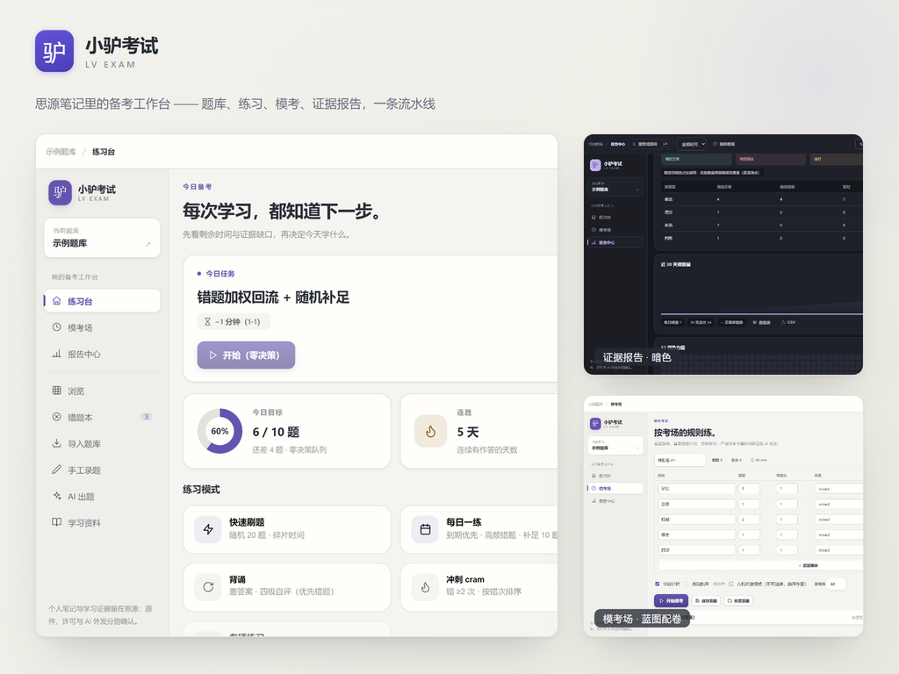

<div align="center">


# 小驴考试 · Lv Exam

**思源笔记里的本地优先备考工作台与做题中枢**

笔记即题库 · 独立主动回忆 · 受助不冒充掌握 · 全真模考与 A4 双栏印卷 · FSRS 闪卡联动

**当前版本：v0.15.2** ｜ [English Documentation](README.en-US.md) ｜ [更新日志](CHANGELOG.md)

[](https://github.com/xiaolv-suite/siyuan-exam/releases)
[](https://b3log.org/siyuan)
[](LICENSE)

[⬇️ 下载安装](#-安装方式) · [🚀 快速上手](#-三步快速上手first-run) · [🖥️ 面板指南](#-各面板与功能视图详解) · [⚙️ 设置参考](#-设置项说明20-项参数与影响) · [⌨️ 快捷键](#-快捷键速查表全键盘优先) · [🔒 隐私承诺](#-数据安全与本地优先承诺)

<br/>



</div>

---

## 🎯 为什么需要小驴考试？它解决什么问题？

传统刷题软件与个人知识库长期割裂，导致“刷题在外部 App、笔记在思源”，看似刷了上千题，实际掌握极度浮于表面：

| 痛点场景 | 传统外部刷题软件 / 纯手工笔记局限 | 小驴考试解决方案 |
| :--- | :--- | :--- |
| **数据孤岛与笔记割裂** | 题库锁在外部商业平台，刷完题无法双链回跳自己的笔记知识点，复习两头切 | **笔记即题库**：试题直接保存在思源原生笔记块中，双链、搜索、引用天然打通，数据 100% 留在本地 |
| **再认错觉与虚假熟练** | 直接看选项容易产生“看懂了以为自己会了”的假象，考场上合上书完全写不出 | **先回忆模式 + 选项随机乱序**：默认遮盖选项强迫主动提取；Fisher-Yates 洗牌打破位置死记硬背 |
| **错题积压与低效重刷** | 错题本越积越多，考前千道错题无从下手，盲目重刷浪费宝贵时间 | **顽疾处置 + 错因靶向攻坚**：连错≥2次标为顽疾，一键组装错题模考卷，定向溯源母题，一键转入 FSRS 闪卡 |
| **主观大题打分飘忽** | 简答题、论述题只能看答案凭感觉给分，无法精准把握得分点 | **采分点量规 (Rubric) 与评分标准**：分项采分点打分与自评，支持历史评分漂移检测与客观对齐 |
| **排版搬运与录题繁重** | 网上下载的试卷题文与答案分离，手工复制一道题要贴四五次 | **整卷智能切题与逆向答案缝合**：直接粘贴未经排版的整卷文本，算法自动分题、切选项并智能将答案解析缝合归位 |

---

## 🌟 核心功能全景

- **📚 笔记即题库与全题型覆盖**：支持单选、多选、判断、填空、简答五大核心题型，原生支持 LaTeX 数学公式、代码高亮与理科化学方程式，题目可随时双链溯源回笔记原文。
- **⚡ 沉浸做题心流与主动回忆**：答对 3.5s 平滑倒计时自动翻题、考前背题速记（Recite Mode）、草稿纸荧光笔手绘圈画线索、选项伪随机洗牌，全键盘快捷选答。
- **🏛️ 题库与闪卡公共集市 (Marketplace)**：常驻一级导航，收录 8 大公版学科体系题库（数理公式/408计算机/英语学术/民法典等），支持跨学科试题篮挑选打包与增量无损差量更新。
- **🎯 错题攻坚与 FSRS 闪卡生态互通**：3 维错因打标（粗心/未掌握/陷阱）、错题顽疾追踪，支持一键将错题转化为符合 FSRS 间隔重复规范的卡片，流转至小驴闪卡。
- **📝 全真模拟考场与 A4 双栏试卷排版**：严格限时倒计时、CBT 答题卡跳题、防漏答强校验、A/B 卷乱序导出，以及一键生成标准 A4 双栏试卷与答题纸。
- **📱 移动端与全屏触控优化**：100vw/100dvh 全屏考试宿主，错题溯源打开笔记时工作台自动优雅收起让位，支持软键盘智能避让与顶栏手势安全退出。

---

## 🖥️ 各面板与功能视图详解

| 导航模块 | 界面名称 | 核心职责与操作指引 |
| :--- | :--- | :--- |
| **今日** (`today`) | **练习台 · 今日驾驶舱** | 聚合今日开工计划卡、连胜打卡周走势、抗遗忘抢救看板与三阶段进阶模式（刷题/背诵/模考）。 |
| **题库** (`bank`) | **题库浏览与治理工坊** | 提供 15 项组合筛选、智能视图保存、题目查看抽屉、考点同义词合并、空考点填充与健康体检。 |
| **错题** (`wrongbook`) | **错题攻坚与消灭中心** | 错因筛选（粗心/未掌握/陷阱）、顽疾错题溯源、变式题特训、错题转 FSRS 闪卡与一键生成专属限时模考卷。 |
| **出题** (`create`) | **多源录题与出题工坊** | 包含四大子工坊：<br>1. **手工录题**：单选/多选/判断/填空/简答，提供理科符号与注音输入；<br>2. **批量导入**：支持 Excel、CSV、TSV、GIFT、Markdown 及整卷智能切题；<br>3. **AI 智能出题**：基于思源文档段落或自填材料提取考点，批量生成并审核采纳；<br>4. **学习资料伴读**：注册讲义材料（PDF/视频/外链），原文批注笔记一键转题。 |
| **背诵** (`recite`) | **概念背诵与纸面伴读** | 仿宋纸面排版，空格键翻转答案，Again/Hard/Good/Easy 四级自评，进度自动暂存可续做。 |
| **模考** (`mock`) | **全真模拟考场** | 标准化限时模考、倒计时静态微光预警、CBT 答题卡、防漏答强校验、A/B 卷生成与 A4 双栏试卷排版。 |
| **复盘** (`report`) | **学情诊断与证据中心** | 初答/受助/复测三口径报告、30天趋势折线图、年度打卡热力图、通关路线图、数据体检与数据出库备份。 |

---

## ⚡ 三步快速上手（First Run）

三步即可完整体验小驴考试从建库、做题到复盘的完整闭环：

```
[第一步：创建/体验题库]  ───▶  [第二步：今日专注开练]  ───▶  [第三步：考场模考与复盘]
 一键创建内置示范题库          全键盘极速刷题 / 标记错因      套用考试蓝图交卷 / 查看雷达图
```

1. **第一步：创建题库（10秒）**
   - 打开练习台（快捷键 `⌥⌘P` / `Ctrl+Alt+P`），在首屏点击 **「创建示例题库（12 题）」**，系统将自动生成包含单选、多选、判断、填空、简答的完整示范题库；
   - *（或在出题工坊点击「智能切题」，直接粘贴整卷文本自动解析）*。
2. **第二步：专注开练（2分钟）**
   - 在首页核心深色重音卡点击 **「开始今日练习」**；
   - 键盘按下 `A`-`D` 极速选答，按下 `Enter` 提交作答并查看深度解析；
   - 答错时按下键盘 `1`（粗心）、`2`（未掌握）或 `3`（陷阱）即时标记错因，按 `V` 键朗读语音。
3. **第三步：考场模考与复盘（3分钟）**
   - 点击侧栏「模考」进入考场，在下拉框选择预设（如行测/教资/中级会计），点击 **「开始全真模考」**；
   - 体验限时倒计时、答题卡跳题与交卷；交卷后自动生成得分、及格线判定、考点雷达图与历史百分位估算！

---

## 📦 安装方式

> **内测说明**：当前版本尚未在思源集市上架（`disabledInPublish: true`），集市搜索不到属预期；请使用发行包或源码本地安装。

1. **发行包手动安装（内测推荐）**：从 [GitHub Releases](https://github.com/xiaolv-suite/siyuan-exam/releases) 下载 `package.zip`，解压至思源工作空间的 `<workspace>/data/plugins/siyuan-exam/` 目录；
2. **源码构建与本地安装**：
   - 环境要求：Node.js `>= 24.0.0`、pnpm `12.x`；
   - 在仓库根目录执行 `pnpm install && pnpm make-install`，或执行 `pnpm make-link` 建立开发软链；
3. **思源集市（内测转正后开放）**：第 7B 组门槛达成并完成上架后开放。

---

## ⚙️ 设置项说明（20 项参数与影响）

思源顶部菜单「设置」→「插件设置」→「小驴考试」中配置，全部选项经 Svelte 响应式派生，**修改确认后即时生效，无需重启插件**：

| 分类分组 | 设置项名称 | 键名 (`key`) | 类型 | 默认值 | 实际作用与影响说明 |
| :--- | :--- | :--- | :---: | :---: | :--- |
| **[考期与目标]** | 目标考试日期 | `examDate` | 文本 | `""` (空) | 格式 `YYYY-MM-DD`。配置后首页启动倒计时，进入考前冲刺姿态。 |
| **[考期与目标]** | 冲刺姿态阈值（天） | `sprintDays` | 数字 | `14` | 距考试 N 天内自动进入冲刺：连错≥2次题目优先占满每日计划配额。 |
| **[考期与目标]** | 每日一练题数 | `dailyGoal` | 数字 | `10` | 每日目标计划推荐题量（到期复习优先 + 高频薄弱考点优先）。 |
| **[考期与目标]** | 多考期档案（可选） | `examProfiles` | 多行 | `""` (空) | 多科考生专用，每行一条 `名称:YYYY-MM-DD`，计划锚定最近未来考期。 |
| **[做题偏好]** | 背诵组大小 | `reciteGroupSize` | 数字 | `15` | 背诵模式每次抽取的题目批量数量（建议 10-25 题）。 |
| **[做题偏好]** | 单题超时提示（秒） | `perQuestionTimeoutS` | 数字 | `0` (关闭) | 练习时单题停留超过该秒数用时徽章变红提示预警；0 为关闭。 |
| **[做题偏好]** | 练习反馈时机策略 | `feedbackTiming` | 下拉 | `immediate` | `immediate`（逐题即时判分）/ `group`（每5题小结）/ `end`（做完集中回看）。 |
| **[做题偏好]** | 材料组交错出题 | `materialInterleave` | 开关 | `false` | 开启后将同一篇大题材料的子题打散到会话各处，防止连续出现相互提示。 |
| **[做题偏好]** | 快速刷题去重窗口（天） | `quickAvoidDays` | 数字 | `3` | 快速刷题自动避开近 N 天内做过的题目（0 为不过滤）。 |
| **[算法调度]** | 期望保留率 (FSRS) | `desiredRetention` | 滑块 | `0.90` | 记忆算法核心参数：越高记得越牢但复习量越大（推荐范围 0.85-0.97）。 |
| **[AI智能体]** | AI 接口地址 | `aiEndpoint` | 文本 | `""` (空) | OpenAI 兼容接口地址（如 `https://api.openai.com/v1`）。 |
| **[AI智能体]** | AI 模型 | `aiModel` | 文本 | `gpt-4o-mini` | 自定义接口所使用的模型名称（思源内置通道忽略此项）。 |
| **[AI智能体]** | 自定义 AI 提示词指令 | `aiCustomHint` | 多行 | `""` (空) | 注入出题与讲解的系统补充指令（如“偏向考研法硕重点”）。 |
| **[AI智能体]** | AI API Key（本地隔离） | `aiKey` | 密码 | `""` (空) | 仅加密保存在本地插件目录中，绝不随题库分享外发。 |
| **[语音音效]** | 默认朗读语言 | `ttsLang` | 下拉 | `zh-CN` | 伴学语音、背诵朗读与听说跟读评测语种（支持普通话/粤语/英语/日语）。 |
| **[语音音效]** | 朗读播放语速 | `ttsRate` | 滑块 | `1.0` | 朗读语速（范围 0.8x-1.5x）。 |
| **[语音音效]** | 成就提示音效 | `soundEnabled` | 开关 | `true` | 答对、全对通关与错题消灭时的清脆提示音。 |
| **[语音音效]** | 常驻显示口语跟读测评 | `speechEvalEnabled` | 开关 | `false` | 默认仅在含语种/注音元数据的题目上自动显示跟读按钮；开启后在所有题目上显示麦克风跟读测评。 |
| **[生态联动]** | 小驴打卡 · 项目 ID | `checkinItemId` | 文本 | `""` (空) | 配置小驴打卡插件项目 ID 后，每日完成练习自动向该项目写入打卡。 |
| **[生态联动]** | 小驴打卡 · 达标题数 | `checkinThreshold` | 数字 | `0` (跟随) | 当日作答达该题数才触发打卡；0 代表跟随「每日一练题数」。 |

> **恢复默认**：可在快捷命令面板（`⌥⌘P` 后按 `⌘K`）执行 `恢复默认设置`，一键写回注册默认值并持久化（`aiKey` 密钥受保护不会被误清）。

---

## ⌨️ 快捷键速查表（全键盘优先）

### 1. 全局导航与呼出
- `⌥⌘P` / `Ctrl+Alt+P`：打开 / 切换至 **练习台**；
- `⌥⌘M` / `Ctrl+Alt+M`：打开 / 切换至 **全真模考场**；
- `⌥⌘R` / `Ctrl+Alt+R`：打开 / 切换至 **学情报告中心**；
- `⌥⌘E` / `Ctrl+Alt+E`：快速直达 **错题本**；
- `⌘K` / `Ctrl+K`：随时呼出 **全局命令面板**（快速切换模式、搜索题库与执行管理命令）；
- `?`（Shift + /）：随时打开 / 关闭 **快捷键速查指南** 弹窗；
- `Esc`：退出当前练习会话 / 关闭当前抽屉或弹窗。

### 2. 专注练习与做题态
- `A` - `J`：快速选中对应的单选 / 多选选项（可多选组合）；
- `Enter`：确认提交作答 / 判分后快速切入下一题；
- `1` - `3`：作答前标记把握度（1确定 2模糊 3盲猜）；答错后一键标记错因（1粗心 2未掌握 3陷阱）；
- `E`：收藏 / 取消收藏当前题目；
- `V`：朗读当前题干（TTS 语音伴学）；
- `H`：请求 AI 阶梯式启发提示（L1思路 → L2公式 → L3步骤）；
- `F`：模考考场中为当前题插上疑义小红旗（Flag）；
- `Z`（或撤销按钮）：撤销上一次误提交（5秒内可回滚本次作答）。

### 3. 沉浸背诵模式
- `Space`（空格键）：翻开答案与解析（先回忆再揭示）；
- `1` - `4`：执行四级记忆自评（1重来 2困难 3良好 4熟练，自动计算 FSRS 间隔）；
- `H`：逐步查看下一层助记提示。

---

## 🔒 数据安全与本地优先承诺

- **本地存储位置**：
  - 试题笔记保存在用户指定的思源笔记本中，享受原生块级版本控制；
  - 刷题记录、错题本索引与用户偏好保存在思源工作空间目录：
    `data/storage/petal/siyuan-exam/`（纯本地 JSON，零外传）。
- **零遥测与受控 AI**：绝不包含任何第三方追踪埋点。AI 出题与解析功能只有在用户主动点击并确认后，才会向用户自行配置的 API 接口发送请求，绝不静默窃取笔记。
- **题目随身带走**：支持一键导出标准 `.lvcards`、CSV 与 Markdown，数据永远属于用户自己。

---

## ❓ 常见问题与故障排查 (FAQ)

### Q1: 我的题目数据存放在哪里？卸载插件会丢失题目吗？
**答：不会丢失。** 题库试题全部保存在你指定的思源原生笔记本中，每一道题都是思源的一个真实块。即使卸载或停用插件，笔记本里的试题内容依然完好无损。

### Q2: 组卷工坊排版时点击导出没有反应怎么办？
**答：** v0.15.1 已彻底修复导出提示被静默捕获的问题，排版并导出时会有清晰的进度微胶囊提示。同时请确保当前思源笔记版本在 v3.8.4 及以上。

### Q3: 手机端做错题溯源，页面会挡在前面吗？
**答：** 不会。从 v0.15.1 起，在手机端点击错题追溯原笔记时，系统会自动打开对应笔记并优雅收起全屏考试弹窗，底层文档即刻清晰呈现。

### Q4: 如何从外部题库批量导入？
**答：** 进入「出题工坊」 -> 点击「批量导入」，支持粘贴整卷文本并点击「智能切题」，系统将自动切分题干、提取选项与判定答案。也可导入 Excel/CSV 表格或 GIFT 格式。

---

## 🐴 小驴系列插件家族

小驴系列插件各自独立，可按需安装和组合使用：

| 插件名称 | 一句话简介 | GitHub 仓库 |
| :--- | :--- | :--- |
| [小驴雷切](https://github.com/xiaolv-suite/siyuan-speed-switch) | 思源中的统一导航与工作上下文平台，连接页签、工作台、片段和快捷入口。 | [xiaolv-suite/siyuan-speed-switch](https://github.com/xiaolv-suite/siyuan-speed-switch) |
| [小驴打卡](https://github.com/xiaolv-suite/siyuan-checkin) | 本地优先的习惯、目标打卡与复盘工作台。 | [xiaolv-suite/siyuan-checkin](https://github.com/xiaolv-suite/siyuan-checkin) |
| [小驴人脉](https://github.com/xiaolv-suite/siyuan-contacts) | 在思源中管理联系人、人际关系、组织归属和重要日期。 | [xiaolv-suite/siyuan-contacts](https://github.com/xiaolv-suite/siyuan-contacts) |
| [小驴拾遗](https://github.com/xiaolv-suite/siyuan-glean) | 整理思源剪藏和导入文章，支持状态分拣、阅读管理与日后回顾。 | [xiaolv-suite/siyuan-glean](https://github.com/xiaolv-suite/siyuan-glean) |
| [小驴考试（内测版）](https://github.com/xiaolv-suite/siyuan-exam) | 本地题库备考工作台，支持多格式导入、刷题、模考、错题复盘与 AI 辅助。 | [xiaolv-suite/siyuan-exam](https://github.com/xiaolv-suite/siyuan-exam) |
| [小驴管家（内测版）](https://github.com/xiaolv-suite/siyuan-home) | 管理家庭与生活资料、成员档案、台账、到期提醒和事务跟进。 | [xiaolv-suite/siyuan-home](https://github.com/xiaolv-suite/siyuan-home) |
| [小驴闪卡（内测版）](https://github.com/xiaolv-suite/siyuan-lv-cards) | 思源中的知识捕获、制卡、练习与复习平台，使用内核原生 FSRS 排期。 | [xiaolv-suite/siyuan-lv-cards](https://github.com/xiaolv-suite/siyuan-lv-cards) |
| [小驴常用（内测版）](https://github.com/xiaolv-suite/xiaolv-common) | 基于思源块保存、搜索并快速调用常用语、模板、代码和链接，支持变量填充。 | [xiaolv-suite/xiaolv-common](https://github.com/xiaolv-suite/xiaolv-common) |

交流与反馈 QQ 群：**871707735**（可反馈 Bug、提交需求和交流使用体验）。

---

## 📝 最近更新动态

- **思源 3.8.10+ 原生特性适配**：全屏机考 CBT 模式协同原生停靠栏折叠与恢复；战报大盘、复盘日志与总览大纲支持右键呼出原生文档树菜单（`showDocTreeNativeMenu`）；半角斜杠标题防截断保护。
- **试题抽屉选项行幽灵空隙根治**：清除历史批量替换遗留的残缺空标签，彻底消除选项行前约 50px 的异常间隙；还原显式 transition 动效属性列表并新增内联样式完整性契约。
- **输入法与触控优化**：题库标签检索、选项快拆、遮盖图 URL 三处输入增加 IME 合成期守卫；移动端/窄屏禁用文本域右下角拖拽把手避免误触变形。
- **性能与工程防线**：日志按构建期门控（开发环境输出，生产环境静默）；抽屉文档搜索 300ms 防抖并加入响应序列守卫杜绝乱序覆盖；全生态剪贴板写入失败覆盖契约固化。

<details>
<summary>展开查看历史版本更新（v0.15.1 及更早版本 · 完整记录见 <a href="./CHANGELOG.md">CHANGELOG.md</a>）</summary>

### v0.15.1（2026-11-10 · GitHub 组织迁移与体验加固）

- **移动端全屏退场机制闭环**：错题溯源打开原笔记后，全屏考试弹窗自动优雅收起，不再遮挡底层文档；
- **组卷工坊排版修复**：排版与导出操作恢复即时微胶囊界面提示，杜绝静默假死感；
- **顶栏罗盘自愈守护**：启动微任务防抖收敛（重绘 8 次 → 1 次），思源重启或云同步后图标由 MutationObserver 自动自愈；
- **输入法防误关守卫**：手机端输入法弹起或表单内滚动时不再误触发全屏关闭手势；
- **仓库与提交身份迁移**：全量迁移至 `xiaolv-suite` 组织。

<details>
<summary>展开查看历史版本更新（v0.15.0 及更早版本 · 完整记录见 <a href="./CHANGELOG.md">CHANGELOG.md</a>）</summary>

### v0.15.0（2026-11-02）

- 做题心流提速：答对 3.5s 平滑倒计时自动翻题、考前背题速记模式（Recite Mode）、选项随机乱序、数理草图画板荧光笔；
- 题库与闪卡公共集市（MarketplaceHub）：8 大公版典藏学科题库、跨学科试题篮与自由组卷、增量差量更新与无损合并、`.lvcards` 双向零损互通；
- 采分点量规 (Rubric) 与多维报告大盘。

</details>

---

## 📄 许可证 (License)

[MIT License](LICENSE) · Copyright (c) 2026 xiaolv-suite
